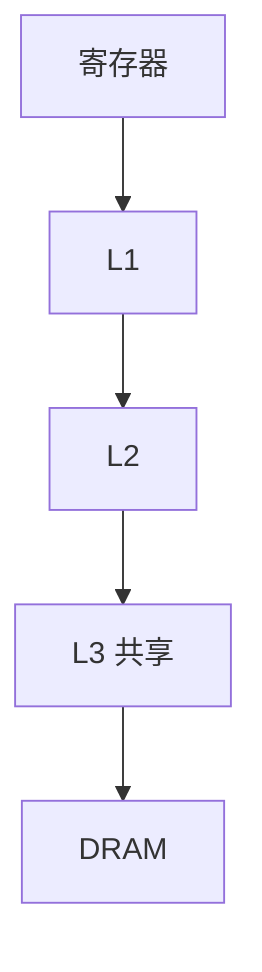

# 高速缓存与局部性

DRAM 延迟以百周期计，寄存器以亚周期到数周期计；其间用多层缓存填平差距。程序的快慢经常不由算术指令条数决定，而由访问模式是否让数据留在靠近核的缓存里。缓存以**固定大小的块（缓存行）**为传输与一致性粒度；谈「碰了一个字节」在硬件上往往意味着「搬了一行、并可能使其他核上的同行副本失效」。

## 层级与缓存行

常见层级：L1i/L1d（每核私有，容量小、延迟低）、L2（常私有）、L3（多核共享，更大更慢），再往下是 DRAM。每一层用标签记录哪些内存块驻留。x86-64 与主流 AArch64 平台上，缓存行大小通常为 **64 字节**。对齐到 64 字节的地址区间作为一个行在层级间移动；未对齐的对象仍按覆盖到的行计，一次访问可跨两行。

组相联：一行可映射到某组内有限个路（way）。冲突缺失出现在多个地址争用同一组且路数不够时；容量缺失出现在工作集大于该层容量时；冷缺失出现在首次触达。预取器根据流式访问模式提前装填，打乱的间接访问（指针追逐、哈希表）使预取失效，缺失率上升。

延迟与带宽逐级变差；共享 L3 上还叠加多核争用。写策略多为写回：脏行在被替换或一致性需要时才写回下层。

## 命中与缺失的代价

L1 命中：通常 3–5 周期量级（随核而异）。L3 命中：十余到数十周期。DRAM：常超百周期，且突发带宽与延迟是不同维度——顺序扫描可利用预取与行缓冲，随机 load 主要吃延迟。一次缓存缺失会堵住依赖该 load 的指令；乱序窗口只能掩盖有限延迟，窗口耗尽后 IPC 塌缩。

写同样经缓存：写分配（write-allocate）下，写缺失先把行读入再改，故「只写」也会产生读带宽。非临时写（如 `movnt*`）可绕过部分缓存层次，用于巨大、不复用的缓冲，避免污染；误用则让后续立刻再读的数据变慢。

指令缓存（I-cache）对热循环通常友好；巨型解释器分发、超大内联、或 JITed 代码不断生成新页，会导致取指缺失与译码压力，表现成「后端计数器干净但 IPC 低」。与 [CPU 流水线与乱序执行](cpu-pipeline.md) 中的前端供给对应。

## 伪共享

缓存一致性协议（如 MESI）以**行为单位**维护多核上的副本状态。核 A 写地址 \(x\)、核 B 写地址 \(y\)，若 \(x\) 与 \(y\) 落在同一缓存行，则两人逻辑上无关的变量会在硬件上反复抢夺该行的独占权：每次写使对方行失效，对方再写再失效。这种现象叫**伪共享（false sharing）**。症状是：共享计数器或「每线程一个元素但相邻存放」的数组，扩展核数后加速比极差，而 `perf` 显示跨核侦听与高 L3/一致性流量。

缓解：按缓存行对齐并填充，使每线程热写落在不同行；或聚合为私有计数再归约。语言里的 `Atomic*`、锁与 channel 并不自动消除伪共享——原子性保证的是序与不可撕，不保证「你的原子变量独占一行」。

真共享（多核读写同一变量）本身需要原子或锁；伪共享是额外的硬件税。诊断时先看布局：两个 `int` 相邻、分别被两线程递增，是典型雷区。

## 局部性：递归 fib 与数组扫描

**时间局部性**：刚访问的地址很快再访问——热循环里的累加器、栈顶、同一行内的字段。**空间局部性**：访问 \(a\) 后不久访问邻近地址——顺序扫数组、结构体顺序字段。缓存行与预取放大空间局部性；指针追逐（链表、树、对象图）破坏空间局部性，每步可能一次缺失。

朴素递归 `fib(n)`：调用树指数膨胀，每次调用触及不同栈帧，返回后帧冷掉；数据工作集是「控制流与栈」，几乎没有对大块连续数据的复用。瓶颈常在调用/返回、栈访问与分支，而不是算术。迭代版或自底向上 DP：在连续数组上填表，空间局部性好，预取有效，缓存命中率高；若表大于末级缓存，仍可能容量缺失，但模式可预测。

同一「斐波那契」标签下，递归与数组 DP 的缓存画像相反。跨语言排名若未固定实现形态（递归是否被尾调用/记忆化/改写为循环），比较的是控制结构与分配，不是加减法本身。数组上的 SIMD 友好扫描进一步依赖对齐与连续布局；语言若每层装箱成堆对象，指针数组扫的是间接引用，局部性退回指针追逐。

行列优先：二维数组按行存储时，内层沿行扫命中空间局部性；内层沿列扫则每步跨过整行字节，对大矩阵几乎每步一行缺失。同一三重循环的 `i,j,k` 排列可差出一个数量级，机制仍是缓存行与预取，不是算术公式变了。结构体数组（AoS）与数组结构体（SoA）的选择，决定「只用到其中一个字段」时是否拖进整行无关数据——带宽敏感核常倾向 SoA，对象语义敏感的代码常留在 AoS。

!!! tip "实验边界"

    用一个大数组顺序求和与按随机下标求和对比墙钟与 `cache-misses`，比空谈「注意局部性」更清楚。伪共享可用两线程分别递增 `a[0]` 与 `a[1]`（紧挨）再改为间隔 16 个 `int`（跨行）对照。具体命令见工具链附录；本章只定机制。

对象布局、堆分配频率如何毁掉局部性，在第四章内存与对象表示中展开；原子指令与屏障在 [存储缓冲与内存序](memory-ordering.md) 与第二章衔接。
