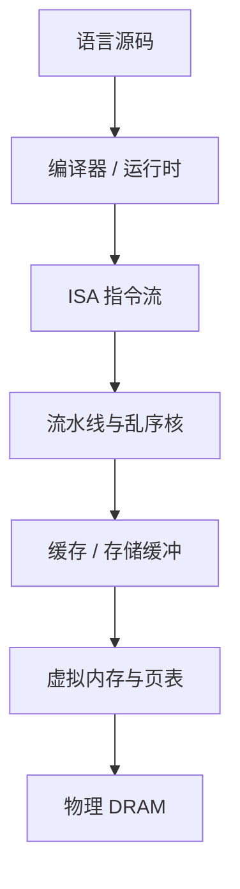

# 机器与表示

第一章把高级语言最终落脚的那一层硬件抽象摊开：比特如何编码整数与浮点，指令如何在流水线与缓存中耗时，地址如何经页表落到物理内存，以及多核对同一存储单元的可见顺序受什么约束。后文讲汇编、ABI、LLVM 优化与语言运行时，都会反复引用这里的词汇；没有这些落点，「语言更快」往往只是测量结果，说不出机制。

本站分层里，第一章对应「硬件抽象层」。它不教你设计 CPU，也不替代体系结构课的完整推导，目标是：在课题讨论中，被追问到补码溢出、缓存行伪共享、页故障、内存序或 ISA 契约时，能指到具体机制，而不是停在口号。阅读说明里的依赖图把本章放在汇编与语言共性之前：没有表示与序的词汇，后面的 ABI、原子与 UB 讨论会悬空。

## 在整条栈中的位置

从上往下读：语言语义先变成指令与数据布局（第二、三章展开），指令进入流水线后，延迟由依赖、预测与发射宽度决定；访存是否命中缓存、是否跨核共享同一缓存行，往往比算术本身更贵；虚地址要经 TLB/页表才到 DRAM。从下往上读：硬件保证的只是 ISA 契约与内存模型；语言层面的「原子」「数据竞争未定义」是在这些保证之上再加约束。第一章把中间几层（比特表示、流水线、缓存、虚存、内存序、ISA）写成可指认的名词。

与后文的分工大致是：

| 本章提供 | 后文承接 |
| --- | --- |
| 整数补码、移位与位宽 | 第二章寄存器宽度；第四章有符号溢出与 UB |
| IEEE 754 舍入与结合律失效 | 基准里 float 路径；跨语言数值语义 |
| 流水线停顿与推测执行 | 同一算法周期差；分支密集代码的读法 |
| 缓存行与局部性 | fib 递归 vs 数组扫描；伪共享与原子 |
| 页表与缺页 | ELF 装载、mmap、栈增长 |
| 存储缓冲与序 | 第二章原子指令；第四章并发模型 |
| ISA 作为契约 | 第二章编码与 ABI；第三章 lowering |

## 章内页面组织

本章按「表示 → 执行时间 → 地址与序 → 指令契约」排列：

1. [比特与整数编码](bits-integers.md)：二进制、补码、端序、移位掩码，以及 C/Rust/Java/Python 等对「整数」的不同承诺。
2. [浮点与舍入](floating-point.md)：IEEE 754 格式、舍入模式、结合律不成立，以及基准里走 float 路径时数字为什么不能直接横比。
3. [CPU 流水线与乱序执行](cpu-pipeline.md)：取指/译码/执行/写回、冒险、推测执行；同算法在不同数据依赖下周期差从何而来。
4. [高速缓存与局部性](cache.md)：缓存行、命中与失效、伪共享；递归 fib 与顺序数组扫描在局部性上的对照。
5. [虚拟内存与页表](virtual-memory.md)：虚实地址、多级页表、TLB、缺页与权限位。
6. [存储缓冲与内存序](memory-ordering.md)：乱序核与 store buffer 为何需要屏障；数据竞争与竞态条件的区分入口。
7. [指令集架构概览](isa-overview.md)：ISA 作为软硬件契约：指令、寄存器、寻址、特权级。
8. [x86-64 与 AArch64 对照](x86-vs-arm.md)：本站主线与对照 ISA 的编码密度、调用习惯与内存模型差异。

前四页解决「数怎么存、指令为什么有时慢」；中间两页解决「地址从哪来、多核看见什么序」；最后两页把「机器码合法含义」钉成契约，供第二章直接在 x86-64 上开写。口试与读基准时最常被点名的硬件侧落点集中在 [比特与整数编码](bits-integers.md)、[高速缓存与局部性](cache.md)、[存储缓冲与内存序](memory-ordering.md)。

## 与口试量规的对接

[口试量规](../Spec/oral-rubric.md) 十条里，第一章直接托住第 7 题（内存序：数据竞争与竞态、store buffer）与第 10 题的硬件侧追问（整数宽度、溢出、浮点路径、局部性导致的数量级差）。第 1–6、8–9 题的主战场在后文，但追问若落到「为什么删检查合法」「为什么换核序就坏」，仍会回到补码、缓存行与序。本章钉住的可指认事实包括：补码加法与语言 UB 的分层、一行 64 字节为何牵动伪共享、缺页与缓存缺失如何叠在墙钟上、TSO 与弱序对「裸 mov 当发布」的不同态度。

## 深度边界

本章写到能支撑上述追问为止：补码与位宽、缓存行粒度、页表行走、TSO/弱序的直觉、ISA 与微架构的分界。不写完整流水线时序图证明、不写页表硬件实现细节手册、不平行铺开第二套 AArch64 全书——AArch64 只在对照页出现。具体指令编码、System V 调用约定、ELF 装载步骤属于第二章；语言抽象机与 UB 条文属于第四章。

章内各页互相交叉引用，而不是各自封闭：整数页指向 UB，浮点页指向基准读法，流水线页指向缓存，缓存页指向伪共享与原子，虚存页指向装载，内存序页指向第二章原子指令与第四章并发，ISA 页与对照页互相收束。未展开的名词跟相对链接；术语见 [术语表](../appendix/glossary.md)。

!!! tip "与基准材料的接法"

    读 [benjdd/languages](https://github.com/bddicken/languages) 一类对照时，先问整数宽度与溢出、是否浮点、是否测到分配/GC/启动，再问算法本身。读法在第六章展开；第一章只提供那些追问所需的硬件词汇。
