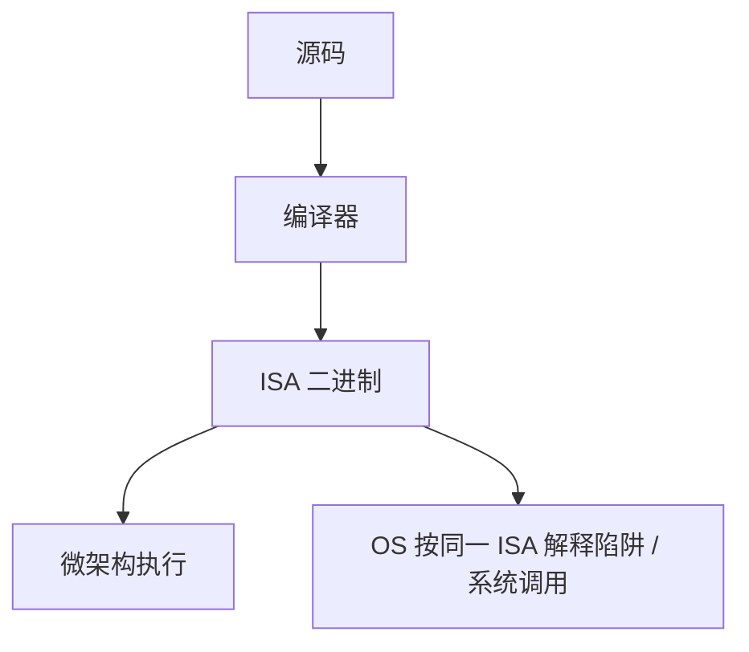

# 指令集架构概览

**指令集架构（ISA）**是软件与硬件之间的契约：有哪些指令、寄存器、寻址方式、特权级、异常与内存模型；二进制在何种规则下有定义行为。微架构（流水线宽度、缓存大小、预测器）决定同一二进制跑得有多快，但不改写契约下的架构状态转移。编译器后端、ABI、操作系统入口都对着 ISA 说话；换微架构通常不用重编译，换 ISA 必须重编译或翻译。

## 契约内容

ISA 至少规定：

- **指令编码与助记语义**：操作码如何划定字段；`add`、`load`、`branch` 对寄存器与内存/标志的影响。
- **寄存器组**：通用、浮点/向量、标志/NZCV、指令指针、栈指针；宽度与别名（如 x86 的 `eax` 是 `rax` 低 32 位）。
- **寻址**：基址+偏移、比例变址、PC 相对；对齐要求（x86 对多数整数 load 较松，AArch64 对未对齐有自己的规则与性能含义）。
- **控制流**：条件码、比较与分支、调用/返回是否压栈、间接跳转。
- **特权与系统态**：用户态禁入的指令、系统调用进入内核的门（`syscall` / `svc`）、异常向量。
- **内存模型**：多核对共享内存的合法观测（见 [存储缓冲与内存序](memory-ordering.md)）。

ABI（如 System V AMD64）在 ISA 之上再约定：哪些寄存器传参、谁保存、栈如何对齐、红区多大。ABI 不是 CPU 晶体管强制的，而是 OS 与编译器生态的契约；同一 ISA 上可有不同 ABI（罕见但存在）。本站主线：Linux x86-64 + SysV。

编译器保证生成的用户态指令序列在 ISA 下实现源语言抽象机（在无 UB 的前提下）；OS 保证系统调用与页表对用户态呈现的虚拟机符合文档。微架构只负责在遵守契约的前提下加速。

## 指令形态

按对程序员的可见效果分类：

| 类 | 作用 | 例子（概念） |
| --- | --- | --- |
| 整数算术逻辑 | 寄存器内计算 | add、xor、shift |
| 数据传送 | 寄存器↔寄存器或内存 | mov/ldr/str |
| 控制流 | 改 PC | jmp/b、call/bl、ret |
| 浮点/SIMD | 向量与标量浮点 | addsd、fadd；打包运算 |
| 原子/屏障 | 不可撕更新与序 | locked RMW、dmb |
| 系统 | 特权、中断、系统调用 | syscall、svc、iret |

CISC（x86）指令变长、一指令可带内存操作数，解码复杂，内部常拆 µop。RISC（AArch64）定长 32 位编码为主、load/store 与运算分离，解码规则更齐。二者在当代核上都会乱序与超标量；「RISC 一定更快」不是契约层命题。对照细节见 [x86-64 与 AArch64 对照](x86-vs-arm.md)。

立即数有宽度限制：装载大常数、远距离跳转需要多条指令或与内存池配合。PC 相对寻址支持位置无关代码（PIC）；第二章用 RIP-relative 具体写。标志位（或 NZCV）把比较与后续条件分支/条件传送耦在一起：一条 `cmp` 的架构效果是改标志，真正改变控制流的是后面的条件跳转；优化器有时把短 if 变成无分支的条件搬移，以降低 [CPU 流水线与乱序执行](cpu-pipeline.md) 中的误预测风险。

用户态看不见特权寄存器与页表基址，但能看见系统调用与陷阱的结果：非法指令、断点、缺页、对齐错误都以架构定义的向量进入内核，再决定信号或终止。调试器断点（`int3` / `brk`）也是这条契约上的一环。

特征位与可选扩展也属契约的一部分：能否用 AVX2、能否用某条原子指令，由 CPUID（或 ARM 的 ID 寄存器）与 OS 保存扩展寄存器状态共同决定。编译器的 `-march`/`target_cpu` 选择生成哪些指令；在旧核上跑含新指令的二进制会得到非法指令异常。发行二进制常取基线 ISA + 运行时分发（IFUNC、fat LTO 的多版本函数）以兼顾广度与速度。

## ISA 与语言语义的夹层

语言说「有符号溢出 UB」「顺序一致原子」；ISA 说「补码加法环绕」「这条 load-acquire 的序」。编译器负责把前者落到后者，并在优化时利用抽象机许可的假设。LLVM IR 介于其间：比 ISA 更贴近语言，比源码更接近机器。若语言语义在 IR 里已丢失（别名、生命周期），后端无法补回——第三章写边界。

内联汇编与手写 asm 直接贴 ISA，绕过多数语言保证；正确性与 ABI 遵守由作者承担。JIT 运行时则动态生成符合当前 ISA 的机器码，并处理缓存一致性（I-cache 与 D-cache 同步），那是另一条「谁保证契约」的路径。模拟器与二进制翻译（如在一种 ISA 上跑另一种 ISA 的用户态）必须复现源 ISA 的用户可见行为，包括内存模型的可观测范围；性能则完全是宿主机微架构的故事。

## 本站用法

读反汇编时，先按 ISA 语义还原「改了哪些寄存器/内存/标志」，再问微架构「为何慢」。优化讨论停留在「少一次 load」是 ISA/编译器层；「命中 L1」是微架构层。二者都要会说，但不混成一句「CPU 不喜欢这行代码」而不指层。同一段 C，在 `-O0` 与 `-O2` 下指令序列不同，但都声称实现同一抽象机；差分阅读时先确认优化是否仍在契约内，再谈哪版更贴热路径。

把「机器码」当成文档读时，单位是指令语义，不是源码行：一条 C 语句可变成多条指令，一条指令也可对应多个 µop。注释与调试信息（DWARF）试图把二者粘回去，但优化会拉断对应；第三章调试页再写。此处只需建立习惯：先信任 ISA 状态转移，再借助符号表与行号做导航。

第二章从寄存器、寻址、编码开始，把 x86-64 契约用到可写出可运行 ELF；本章只钉住：ISA 是稳定契约，缓存与流水线是契约之下的实现。与 [虚拟内存与页表](virtual-memory.md) 合起来，构成「用户态程序看见的虚拟机」：指令按 ISA 执行，地址按页表翻译，多核共享按内存模型观测。
