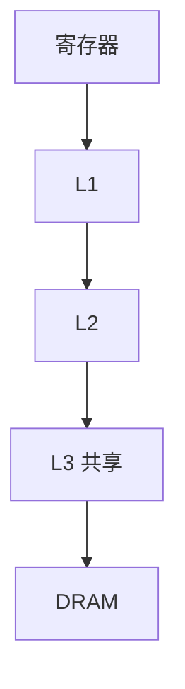
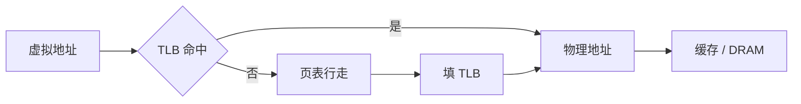
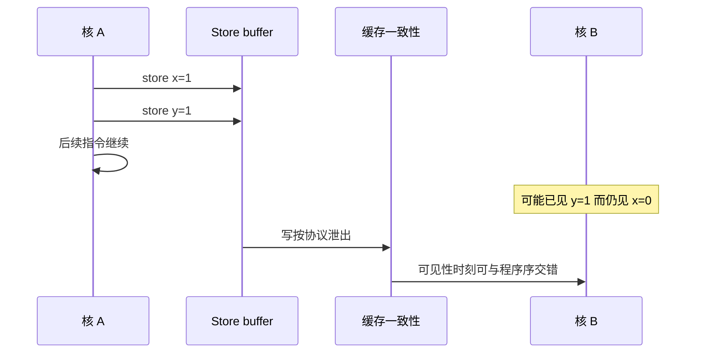
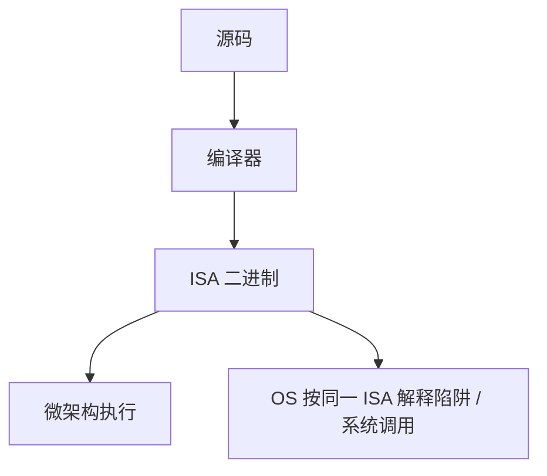

# 执行、存储与指令契约

指令并不按「一行源码一步算术」执行。流水线与乱序、缓存与虚存、存储缓冲与内存序，决定延迟和跨线程可见性。指令集（ISA）是软件能够依赖的那一层规则。

### 经典五级与当代核

教学用五级流水线把一条指令拆成：

1. **取指（Fetch）**：按 PC 从指令缓存取字节，预解码或对齐。
2. **译码（Decode）**：识别操作码、操作数、立即数；x86 变长指令在此更重，常再拆成内部微操作（µop）。
3. **执行（Execute）**：ALU、地址生成、分支解析、浮点/SIMD 等功能单元。
4. **访存（Memory）**：对 load/store 访问数据缓存（有的模型把执行与访存分开画）。
5. **写回（Writeback）**：把结果写入寄存器文件；在乱序核中，真正对架构可见的提交（retire）还要满足按序与异常条件。

当代乱序超标量核在此之上增加：指令窗口与重排序缓冲（ROB）、寄存器重命名、多端口发射、负载/存储队列、分支预测器与指令/数据预取。程序员仍只看见 ISA 状态在「提交点」按程序顺序更新；中间的乱序与推测对正确单线程语义透明，对性能与侧信道则不透明。

读图时从左到右是一条指令的生命期；同一时刻窗口内有许多指令停在不同框。停顿发生在某框供不应求或依赖未满足时。

### 冒险

三类经典冒险决定流水线能否满载：

**结构冒险**：两个 µop 争用同一执行端口、同一缓存端口或同一译码带宽。指令混合（纯整数 vs 混浮点/SIMD/分支）改变端口压力，故「指令数相同」不等于「吞吐相同」。

**数据冒险**：后面的指令需要前面的结果。真依赖（读后写）必须等；写后写、写后读在架构寄存器上看起来冲突，可由**寄存器重命名**拆开，使无关的写并行。循环里一条长依赖链（例如每次迭代 `acc = acc * a + b` 形成串行）会把指令窗口填满却发不出去，IPC 远低于峰值。打破依赖（代数变形、展开后重排、软件流水）是编译器与手写内核的常见活。

**控制冒险**：分支目标在解析前未知。流水线若空等，气泡昂贵。现代核用分支预测继续取指；预测错误则冲洗错误路径上的推测指令，从正确目标重启，惩罚可达十余到数十周期量级（随微架构而变）。

### 推测执行

分支预测是最常见的推测：沿预测路径取指、执行，提交前核对。预测正确则吞吐接近无分支；错误则付冲洗代价。间接跳转、返回地址（RAS）、循环结束条件都有各自的预测结构。数据侧也有推测：依赖预测、内存消歧（假定 load 与更早 store 不别名而提前执行 load），失败则重放。

推测使「单线程看起来按序」与「硅片上已执行了错误路径」同时成立。Spectre 类问题利用的是：推测路径上的缓存状态等微架构副作用在冲洗后仍可被测量。本站不展开攻击细节；只需在讨论性能与安全边界时，把「架构状态」和「微架构状态」分开说。

异常与精确中断要求：对外可见的寄存器与内存更新停在故障指令之前。乱序核用 ROB 按序提交保证这一点；故障路径上已执行的 µop 被丢弃。这与「语言里的异常」不是同一层，但解释了为何硬件可以乱序却仍实现精确异常模型。

### 同算法不同周期

把算法固定为「对数组做一类归约」或「递归 fib」，周期差来源通常是：

| 因素 | 机制 |
| --- | --- |
| 依赖链长度 | 串行累加 vs 可并行归约树；限制发射窗口效率 |
| 分支可预测性 | 数据有序时预测接近完美；随机分支使误预测冲洗频繁 |
| 指令混合 | 除法、非规格化浮点、复杂寻址占用少端口长延迟单元 |
| 前端供给 | I-cache 缺失、x86 变长译码瓶颈、跳转密集导致取指断裂 |
| 后端访存 | D-cache 缺失；见 [高速缓存与局部性](cache.md) |
| 推测与重放 | 错误的内存消歧、商店到加载转发失败 |

朴素递归 fibonacci：每层两次调用与一次加法，指令流充满调用/返回与栈访问，依赖浅但控制流密、局部性差；迭代 fib 依赖链在标量累加上，分支规律，缓存友好。二者「算法关系」相同（都算斐波那契），微架构画像完全不同。跨语言基准若一个走递归、一个被优化成迭代或查表，排名反映的是优化是否改写了控制流，而不是语言虚空的快慢。

除法、平方根、部分加密指令的延迟远高于加减；一条依赖链上的 `div` 会把后面的 µop 堵在窗口里。编译器把除以常数变成乘法魔法数，是在缩短这条链。软件流水与循环展开增加寄存器压力，换取依赖链重叠；寄存器溢出到栈则把问题部分转移成缓存流量。

测量上：`perf` 的 cycles、instructions、IPC、branch-misses、cache-misses 把上述因素拆开。IPC 接近该核峰值（常见标量整数核远低于「每周期多条」的理论顶）且 cache/branch 计数干净时，瓶颈更可能在依赖链或端口压力；IPC 很低且缺失计数高时，先治访存与预测。只报墙钟时间时，应能口头列出「依赖、分支、缓存」三类假说，再决定加哪类计数器。ISA 层契约见 [指令集架构概览](isa-overview.md)；多核对访存的可见顺序见 [存储缓冲与内存序](memory-ordering.md)。

算得快慢经常不在算术本身，而在数据是否还在附近的缓存行里。

DRAM 延迟以百周期计，寄存器以亚周期到数周期计；其间用多层缓存填平差距。程序的快慢经常不由算术指令条数决定，而由访问模式是否让数据留在靠近核的缓存里。缓存以**固定大小的块（缓存行）**为传输与一致性粒度；谈「碰了一个字节」在硬件上往往意味着「搬了一行、并可能使其他核上的同行副本失效」。

### 层级与缓存行

常见层级：L1i/L1d（每核私有，容量小、延迟低）、L2（常私有）、L3（多核共享，更大更慢），再往下是 DRAM。每一层用标签记录哪些内存块驻留。x86-64 与主流 AArch64 平台上，缓存行大小通常为 **64 字节**。对齐到 64 字节的地址区间作为一个行在层级间移动；未对齐的对象仍按覆盖到的行计，一次访问可跨两行。

组相联：一行可映射到某组内有限个路（way）。冲突缺失出现在多个地址争用同一组且路数不够时；容量缺失出现在工作集大于该层容量时；冷缺失出现在首次触达。预取器根据流式访问模式提前装填，打乱的间接访问（指针追逐、哈希表）使预取失效，缺失率上升。

延迟与带宽逐级变差；共享 L3 上还叠加多核争用。写策略多为写回：脏行在被替换或一致性需要时才写回下层。

### 命中与缺失的代价

L1 命中：通常 3–5 周期量级（随核而异）。L3 命中：十余到数十周期。DRAM：常超百周期，且突发带宽与延迟是不同维度——顺序扫描可利用预取与行缓冲，随机 load 主要吃延迟。一次缓存缺失会堵住依赖该 load 的指令；乱序窗口只能掩盖有限延迟，窗口耗尽后 IPC 塌缩。

写同样经缓存：写分配（write-allocate）下，写缺失先把行读入再改，故「只写」也会产生读带宽。非临时写（如 `movnt*`）可绕过部分缓存层次，用于巨大、不复用的缓冲，避免污染；误用则让后续立刻再读的数据变慢。

指令缓存（I-cache）对热循环通常友好；巨型解释器分发、超大内联、或 JITed 代码不断生成新页，会导致取指缺失与译码压力，表现成「后端计数器干净但 IPC 低」。与 [CPU 流水线与乱序执行](cpu-pipeline.md) 中的前端供给对应。

### 伪共享

缓存一致性协议（如 MESI）以**行为单位**维护多核上的副本状态。核 A 写地址 \(x\)、核 B 写地址 \(y\)，若 \(x\) 与 \(y\) 落在同一缓存行，则两人逻辑上无关的变量会在硬件上反复抢夺该行的独占权：每次写使对方行失效，对方再写再失效。这种现象叫**伪共享（false sharing）**。症状是：共享计数器或「每线程一个元素但相邻存放」的数组，扩展核数后加速比极差，而 `perf` 显示跨核侦听与高 L3/一致性流量。

缓解：按缓存行对齐并填充，使每线程热写落在不同行；或聚合为私有计数再归约。语言里的 `Atomic*`、锁与 channel 并不自动消除伪共享——原子性保证的是序与不可撕，不保证「你的原子变量独占一行」。

真共享（多核读写同一变量）本身需要原子或锁；伪共享是额外的硬件税。诊断时先看布局：两个 `int` 相邻、分别被两线程递增，是典型雷区。

### 局部性：递归 fib 与数组扫描

**时间局部性**：刚访问的地址很快再访问——热循环里的累加器、栈顶、同一行内的字段。**空间局部性**：访问 \(a\) 后不久访问邻近地址——顺序扫数组、结构体顺序字段。缓存行与预取放大空间局部性；指针追逐（链表、树、对象图）破坏空间局部性，每步可能一次缺失。

朴素递归 `fib(n)`：调用树指数膨胀，每次调用触及不同栈帧，返回后帧冷掉；数据工作集是「控制流与栈」，几乎没有对大块连续数据的复用。瓶颈常在调用/返回、栈访问与分支，而不是算术。迭代版或自底向上 DP：在连续数组上填表，空间局部性好，预取有效，缓存命中率高；若表大于末级缓存，仍可能容量缺失，但模式可预测。

同一「斐波那契」标签下，递归与数组 DP 的缓存画像相反。跨语言排名若未固定实现形态（递归是否被尾调用/记忆化/改写为循环），比较的是控制结构与分配，不是加减法本身。数组上的 SIMD 友好扫描进一步依赖对齐与连续布局；语言若每层装箱成堆对象，指针数组扫的是间接引用，局部性退回指针追逐。

行列优先：二维数组按行存储时，内层沿行扫命中空间局部性；内层沿列扫则每步跨过整行字节，对大矩阵几乎每步一行缺失。同一三重循环的 `i,j,k` 排列可差出一个数量级，机制仍是缓存行与预取，不是算术公式变了。结构体数组（AoS）与数组结构体（SoA）的选择，决定「只用到其中一个字段」时是否拖进整行无关数据——带宽敏感核常倾向 SoA，对象语义敏感的代码常留在 AoS。

!!! tip "实验边界"

    用一个大数组顺序求和与按随机下标求和对比墙钟与 `cache-misses`，比空谈「注意局部性」更清楚。伪共享可用两线程分别递增 `a[0]` 与 `a[1]`（紧挨）再改为间隔 16 个 `int`（跨行）对照。具体命令见工具链附录；本章只定机制。

对象布局、堆分配频率如何毁掉局部性，在第四章内存与对象表示中展开；原子指令与屏障在 [存储缓冲与内存序](memory-ordering.md) 与第二章衔接。

缓存谈的是速度；虚存谈的是名字：程序看见的地址如何落到物理页。

每个用户态进程看见的是私有的**虚拟地址空间**，而非直接的物理 DRAM 字节编号。CPU 在访存时把虚拟地址翻译成物理地址；操作系统用页表描述映射，并用缺页、权限位实现按需装入、写时复制与隔离。链接器写出的 ELF 虚拟地址、`mmap` 返回的指针、栈与堆的增长，都建立在这套翻译之上。

### 虚地址与页

地址空间划成固定大小的**页**（page）；常见 4 KiB，另有 2 MiB/1 GiB 大页（huge page）。虚拟页号经页表查到物理页帧号，页内偏移原样保留。对齐到页的映射使权限与存在位以页为粒度：一页内不能一半可执行一半不可写——更细的保护要靠更大页拆小或接受整页同权。

x86-64 长期以 48 位规范虚地址为主（高位符号扩展），近年可选 57 位（5 级页表）。规范地址之外的编码触发故障。用户态看到的「指针是 64 位」与「可用规范空间远小于 \(2^{64}\)」同时成立。物理地址宽度由平台决定，经内存控制器接到 DRAM 与 MMIO。

翻译在缓存查找的标签路径上完成；缓存可用虚索引实标签等实现变体，但对软件的模型仍是：先（逻辑上）得到物理地址，再在存储层级中找数据。

### 多级页表与 TLB

全平坦页表过大；硬件采用多级页表（x86-64 常见 4 级）。虚页号拆成多段索引，逐级走到叶页表项（PTE）。PTE 含物理页帧号、存在位、读写/用户/执行权限、脏位、访问位等。页表本身也占物理内存，由 OS 维护；用户态指令只读结果，不直接改页表（除经系统调用/`mmap` 等请求）。

每次访存若都走多级行走，代价过高。**TLB**（Translation Lookaside Buffer）缓存近期虚→实翻译。TLB 命中则翻译快；缺失则硬件（或协助）行走页表并填 TLB。工作集若触达大量不同页（大跨度随机访问、巨量小对象散落），TLB 缺失会叠加在缓存缺失之上，形成「页行走风暴」。大页用一个 TLB 项覆盖更大区间，降低 TLB 压力，代价是内部碎片与分配灵活性。

切换地址空间（进程切换）时，TLB 需按 ASID/PCID 等机制隔离或冲洗；线程同进程共享页表，切换更轻。fork 的写时复制：父子共享物理页，PTE 标只读，任一方写入时缺页，OS 复制页并更新映射。

### 缺页与权限

访问「存在位为 0」的页产生**缺页异常**：可能是按需从文件/匿名页填入（合法），也可能是真正的非法访问（段错误）。写只读页：可能是 COW 或文本段保护。执行不可执行页：NX/XN 位阻止数据页当代码跑，缓解部分注入攻击。用户态访问内核地址、或权限不足，同样故障。

栈增长：许多 OS 对栈下方保留映射或特殊处理，访问「栈红区之下」可触发扩展或信号；细节属 OS，但解释了为何深递归先碰上栈溢出而非默默写进堆。`mmap` 可预留巨大虚空间而不立刻占物理页；真正 touch 时才分配帧——测内存时要分清虚拟承诺与常驻集（RSS）。

文件映射把页框与文件缓存统一：同一文件页可映射进多进程。ELF 装载把段映射进虚地址（第二章）；调试器改代码页权限、JIT 写后改可执行，都是权限位切换的应用。匿名页首次写入前，Linux 等常映射共享的零页并标只读，写时再分配私有帧——大数组「分配」与「真正摸热」的成本因此分离。

页表项里的 NX/执行禁止、用户/监督位与只读位，构成 W^X 等安全策略的硬件支点：典型流程是先把页映射为可写不可执行以生成代码，再切换为可执行不可写。用户态若绕过 OS 直接改页表，在受保护的 CPU 模式下不可行；所有合法变更都经系统调用或内核路径。

### 与程序性能的交界

| 现象 | 机制 |
| --- | --- |
| 首次触达大数组变慢 | 冷缺页填零页或读磁盘；之后才进入纯缓存问题 |
| 多进程共享库 | 文本段物理页共享；写数据段 COW |
| 随机指针满地址空间飞 | TLB 与缓存双缺失 |
| 栈上大数组 | 可能连续缺页；也可因栈限被杀 |
| 访问已 `munmap` 或野指针 | 故障；语言运行时的「空安全」在此之前已拦一层 |

用户态地址空间布局（ASLR）把栈、堆、mmap 区、库的基址随机化，使攻击者难以写死地址；对性能的影响主要是可预测性与热库地址变化，稳态算核通常不敏感。内核地址空间与用户空间隔离：用户指针传入系统调用时，内核必须显式探访并校验范围，不能假定用户指针可直接解引用——这是 OS 安全边界，不是语言类型系统。

虚拟内存不消除 [高速缓存与局部性](cache.md) 的问题：翻译成功后，数据仍可能 L1/L3/DRAM 缺失。它增加了一层：页是否存在、是否有权、TLB 是否命中。基准若包含「第一次跑」或「每次重新分配大缓冲」，缺页与清页成本会进墙钟；稳态测感应剔除或单独报告。大页（`madvise`/显式 huge tlb）适合工作集大且访问面广的科学计算与某些数据库缓冲池；对碎片化严重的小对象堆帮助有限。

!!! note "与内存序的边界"

    页表与 TLB 决定「这个地址有没有映射到哪帧」；[存储缓冲与内存序](memory-ordering.md) 决定「多核对同一物理帧上已提交写的可见顺序」。缺页处理中的锁与 TLB 射击是 OS 并发问题；用户态原子操作通常假定页已映射且可写。

多核能同时绕过彼此的直觉顺序。内存序把「何时可见」收成可以推理的规则。

单线程里，编译器与 CPU 都可重排无关操作，只要对当前线程的观测仍符合「仿佛按程序顺序」。多线程共享内存时，每个核各自的「仿佛按序」并不合成一条全局唯一的写时间线。存储缓冲、无效队列与乱序发射让一核对写的完成，与另一核看见该写的时刻脱节；硬件内存模型规定哪些脱节合法，语言内存模型再规定编译器可做哪些重排、何种访问算同步。口试第 7 题的落点是：说清 **store buffer 与乱序为何需要序**，并一句话分开 **数据竞争** 与 **竞态条件**。

### 单核：store buffer 与转发

核执行 store 时，通常先把写放入**存储缓冲（store buffer）**，不必等该缓存行进入独占态、写对一致性协议可见，就可以继续后续指令。同核稍后 load **同一地址**时，往往从 store buffer **转发**，自己立刻看见自己的写。其他核在该写泄出并完成一致性握手之前，仍可读到旧值。

因此「程序序上先写 `x` 再写 `y`」只约束本核对自身的观测；对他核而言，`y` 的新值完全可能先于 `x` 的新值出现——除非硬件模型禁止这类重排，或软件插入了屏障/释放语义的写。Load 相对其他 load/store 的重排在弱序 ISA 上更常见；即便在较强的模型里，**store 后跟一条无关地址的 load** 仍是最典型的松弛点，其微观原因正是 store 还停在 buffer 里，后面的 load 已经命中了本地缓存。

与 [CPU 流水线与乱序执行](cpu-pipeline.md) 的分工：流水线乱序解释的是单核如何重叠执行却按序提交架构状态；内存序解释的是**已提交的写**以何种规则对他核变得可见。把「乱序执行」直接说成「多核内存模型」是混层——前者主要是吞吐机制，后者是共享内存的观测契约。推测路径上的写在冲洗后不进入架构可见状态；跨核可见性靠一致性协议与缓冲泄出，不靠错误路径上的缓存副作用。

### 硬件模型：TSO 与弱序

**x86-64** 对普通 load/store 提供接近 **总存储序（TSO）** 的模型：store 之间的顺序通常保留；允许的典型松弛是 store-load，即后一条 load 越过仍在 store buffer 中的先写。许多在弱序机器上需要显式屏障的写法，在 x86 上「碰巧」正确，换 AArch64 才暴露。

**AArch64** 默认更弱：普通访问可发生更多种重排。建立序要靠屏障（`dmb`/`dsb` 等）或带 **acquire / release** 语义的 load/store 变体。对照见 [x86-64 与 AArch64 对照](x86-vs-arm.md)。

口头可用消息传递直觉：线程 A 写 `data`，再写 `flag=1`；线程 B 读到 `flag==1` 后读 `data`。若两处都是普通读写且无屏障，弱序机器上 B 可能看见 `flag==1` 而 `data` 仍是旧值。TSO 上 store-store 顺序通常仍在，但若中间夹了编译器重排，或 `flag` 的读与别的写之间缺少 acquire，仍可能错——故「硬件较强」不等于「语言层普通变量可当信号用」。

### 屏障与原子 RMW

**屏障（fence）**限制重排与缓冲泄出的种类：

| 意图 | 作用直觉 |
| --- | --- |
| StoreStore | 先前 store 对一致性可见后，才执行后续 store |
| LoadLoad | 先前 load 完成后，才执行后续 load |
| LoadStore / StoreLoad | 对应另外两种交叉；StoreLoad 通常最重，常要排空 store buffer |
| 全屏障 | 近似禁止跨越该点的所有上述重排 |

x86 上 `mfence` 是显式全屏障；带 `lock` 前缀的读改写、以及 `xchg` 等，往往附带强序效果。日常代码很少手写 `mfence`，更多依赖锁前缀原子 RMW 或编译器对原子内建的降级。AArch64 用 `dmb`/`dsb` 与 acquire/release 访问表达更细的序，代价与粒度更可见。

原子读改写（CAS、fetch-add、xchg）在硬件上对该地址取得独占并完成不可撕更新，同时按指令语义附带一定序约束。它们提供「更新不可撕 + 所需可见序」；不消除 [高速缓存与局部性](cache.md) 里的伪共享——两个原子变量仍可挤在同一缓存行上互相踢行。具体操作码与 `lock` 前缀在第二章 [原子指令与内存序指令](../ch02/atomics-x86.md) 展开。

### 语言内存模型与编译器重排

硬件模型约束的是**已生成的指令**在多核上的可见性。语言内存模型额外约束：

1. **编译器**可否把普通 load/store 挪过同步点、合并、删除；
2. 何种源构造建立 **happens-before**（或等价同步边）；
3. 违反规则时是 UB、是数据竞争下的弱保证，还是直接禁止编译。

没有同步边时，编译器可以把线程 A 里的 `data=…` 与 `flag=1` 对调，或把 `flag` 读出的值缓存进寄存器、不再去内存——在单线程 as-if 下合法，在「用普通变量当发布信号」的用法下崩溃。因此「CPU 是 TSO」挡不住「编译器先把你的序拆掉」。

常见降级关系（直觉，非完整规范）：

| 语言层概念 | 落到硬件时的粗映射 |
| --- | --- |
| 互斥锁 unlock / lock | 释放与获取；常生成屏障或带序的原子存取 |
| C++/Rust `memory_order_relaxed` | 原子性（不可撕）为主，几乎不建序 |
| `acquire` / `release` | 单向屏障；配对后形成 happens-before |
| `seq_cst` | 全序直觉更强；x86 上常仍是普通/带锁指令，弱序 ISA 上更重 |
| Java `volatile` | 近似 acquire/release + 可见性；与 C 的 `volatile`（禁止编译器优化该对象、不建多线程序）不是同一概念 |
| C `volatile` | 不对多线程同步；不能当便携内存屏障用 |

讨论 `atomic` / `volatile` 时，先问「哪门语言的哪条规则」，再问「降到本机 ISA 会变成什么指令」。导师清单里的 happens-before，指的就是这类同步边：锁的释放对获取、线程 `join`、发布-订阅的 release/acquire 等。无边则无跨线程的「我写完了你一定看见」承诺。

### 数据竞争与竞态条件

**数据竞争（data race）**：两个线程并发访问同一内存位置，至少一次是写，且该访问未经语言定义的原子或同步机制排序。定义随语言微调，但「冲突 + 并发 + 缺同步」这一骨架稳定。

- 在 **C++**（及相近的 LLVM 语言抽象）中，数据竞争是**未定义行为**：编译器可假设不存在，从而删除检查、跨线程重排普通访问。
- **Rust** 在安全子集里用类型系统拒绝数据竞争；`unsafe` 中的数据竞争仍按「不可接受 / 近 UB」处理。
- **Java** 对数据竞争给出的是较弱、但仍受 JMM 约束的语义（不是「任意 UB」），却仍不是正确写法；需要的是 `synchronized` / `volatile` / `java.util.concurrent` 原子类等。
- **Go** 的模型强调 happens-before；数据竞争可用 race detector 抓，规范上将其视为错误。

**竞态条件（race condition）**是更宽的**正确性**概念：程序结果依赖调度与时序，哪怕每一次内存访问都有原子或锁，仍可能逻辑错误——典型如 TOCTOU（先检查后使用之间状态已变）、锁粒度盖不住的不变量、两个原子变量之间缺少成对发布。

对照口试一句：

- 数据竞争：内存模型层面的非法（或未定义）并发访问形态；
- 竞态条件：算法/逻辑层面的时序敏感错误。

有数据竞争时常伴随竞态；**无数据竞争仍可有竞态**（两个 `AtomicBool` 配错协议就是例子）。把「我用了原子」说成「没有竞态」不成立；把「有竞态」说成「一定有数据竞争」也不成立。

### 与基准解读的关系

共享可变状态的默认路径是互斥或等价同步。无锁路径必须显式选择原子序，并在脑内跑一遍「发布端 release、订阅端 acquire」是否配对。x86 上把 acquire/release 降成 `relaxed` 仍可能通过测试；同一二进制逻辑移植到 AArch64 或换编译器版本才失败——这是内存序 bug 的典型画像。

高争用锁的成本往往是缓存行在核间弹跳与陷入内核，而不只是「多几条原子指令」。低争用下，未争用的锁在 x86 上可能接近一次原子存储量级。读并发基准时标明核数与争用；伪共享见 [高速缓存与局部性](cache.md)。第四章 concurrency 页用语言模型收束；第二章接具体原子指令。

!!! example "口试第 7 题答法提纲"

    （1）数据竞争是缺同步的冲突并发访问，在 C++ 等是 UB；竞态条件是时序导致的逻辑错误，有锁仍可能发生。（2）store 进入 store buffer 后本核可继续，他核暂时不见；乱序与缓冲使程序序 ≠ 全局可见序。（3）语言用 happens-before / 原子 / 锁约束编译器与降级后的屏障；硬件用 TSO 或弱序 + fence/acquire-release 约束指令观测。指回本页与第二章原子指令即可。

上面这些能力，对软件暴露出来的界面就是 ISA。

**指令集架构（ISA）**是软件与硬件之间的契约：有哪些指令、寄存器、寻址方式、特权级、异常与内存模型；二进制在何种规则下有定义行为。微架构（流水线宽度、缓存大小、预测器）决定同一二进制跑得有多快，但不改写契约下的架构状态转移。编译器后端、ABI、操作系统入口都对着 ISA 说话；换微架构通常不用重编译，换 ISA 必须重编译或翻译。

### 契约内容

ISA 至少规定：

- **指令编码与助记语义**：操作码如何划定字段；`add`、`load`、`branch` 对寄存器与内存/标志的影响。
- **寄存器组**：通用、浮点/向量、标志/NZCV、指令指针、栈指针；宽度与别名（如 x86 的 `eax` 是 `rax` 低 32 位）。
- **寻址**：基址+偏移、比例变址、PC 相对；对齐要求（x86 对多数整数 load 较松，AArch64 对未对齐有自己的规则与性能含义）。
- **控制流**：条件码、比较与分支、调用/返回是否压栈、间接跳转。
- **特权与系统态**：用户态禁入的指令、系统调用进入内核的门（`syscall` / `svc`）、异常向量。
- **内存模型**：多核对共享内存的合法观测（见 [存储缓冲与内存序](memory-ordering.md)）。

ABI（如 System V AMD64）在 ISA 之上再约定：哪些寄存器传参、谁保存、栈如何对齐、红区多大。ABI 不是 CPU 晶体管强制的，而是 OS 与编译器生态的契约；同一 ISA 上可有不同 ABI（罕见但存在）。本站主线：Linux x86-64 + SysV。

编译器保证生成的用户态指令序列在 ISA 下实现源语言抽象机（在无 UB 的前提下）；OS 保证系统调用与页表对用户态呈现的虚拟机符合文档。微架构只负责在遵守契约的前提下加速。

### 指令形态

按对程序员的可见效果分类：

| 类 | 作用 | 例子（概念） |
| --- | --- | --- |
| 整数算术逻辑 | 寄存器内计算 | add、xor、shift |
| 数据传送 | 寄存器↔寄存器或内存 | mov/ldr/str |
| 控制流 | 改 PC | jmp/b、call/bl、ret |
| 浮点/SIMD | 向量与标量浮点 | addsd、fadd；打包运算 |
| 原子/屏障 | 不可撕更新与序 | locked RMW、dmb |
| 系统 | 特权、中断、系统调用 | syscall、svc、iret |

CISC（x86）指令变长、一指令可带内存操作数，解码复杂，内部常拆 µop。RISC（AArch64）定长 32 位编码为主、load/store 与运算分离，解码规则更齐。二者在当代核上都会乱序与超标量；「RISC 一定更快」不是契约层命题。对照细节见 [x86-64 与 AArch64 对照](x86-vs-arm.md)。

立即数有宽度限制：装载大常数、远距离跳转需要多条指令或与内存池配合。PC 相对寻址支持位置无关代码（PIC）；第二章用 RIP-relative 具体写。标志位（或 NZCV）把比较与后续条件分支/条件传送耦在一起：一条 `cmp` 的架构效果是改标志，真正改变控制流的是后面的条件跳转；优化器有时把短 if 变成无分支的条件搬移，以降低 [CPU 流水线与乱序执行](cpu-pipeline.md) 中的误预测风险。

用户态看不见特权寄存器与页表基址，但能看见系统调用与陷阱的结果：非法指令、断点、缺页、对齐错误都以架构定义的向量进入内核，再决定信号或终止。调试器断点（`int3` / `brk`）也是这条契约上的一环。

特征位与可选扩展也属契约的一部分：能否用 AVX2、能否用某条原子指令，由 CPUID（或 ARM 的 ID 寄存器）与 OS 保存扩展寄存器状态共同决定。编译器的 `-march`/`target_cpu` 选择生成哪些指令；在旧核上跑含新指令的二进制会得到非法指令异常。发行二进制常取基线 ISA + 运行时分发（IFUNC、fat LTO 的多版本函数）以兼顾广度与速度。

### ISA 与语言语义的夹层

语言说「有符号溢出 UB」「顺序一致原子」；ISA 说「补码加法环绕」「这条 load-acquire 的序」。编译器负责把前者落到后者，并在优化时利用抽象机许可的假设。LLVM IR 介于其间：比 ISA 更贴近语言，比源码更接近机器。若语言语义在 IR 里已丢失（别名、生命周期），后端无法补回——第三章写边界。

内联汇编与手写 asm 直接贴 ISA，绕过多数语言保证；正确性与 ABI 遵守由作者承担。JIT 运行时则动态生成符合当前 ISA 的机器码，并处理缓存一致性（I-cache 与 D-cache 同步），那是另一条「谁保证契约」的路径。模拟器与二进制翻译（如在一种 ISA 上跑另一种 ISA 的用户态）必须复现源 ISA 的用户可见行为，包括内存模型的可观测范围；性能则完全是宿主机微架构的故事。

### 本站用法

读反汇编时，先按 ISA 语义还原「改了哪些寄存器/内存/标志」，再问微架构「为何慢」。优化讨论停留在「少一次 load」是 ISA/编译器层；「命中 L1」是微架构层。二者都要会说，但不混成一句「CPU 不喜欢这行代码」而不指层。同一段 C，在 `-O0` 与 `-O2` 下指令序列不同，但都声称实现同一抽象机；差分阅读时先确认优化是否仍在契约内，再谈哪版更贴热路径。

把「机器码」当成文档读时，单位是指令语义，不是源码行：一条 C 语句可变成多条指令，一条指令也可对应多个 µop。注释与调试信息（DWARF）试图把二者粘回去，但优化会拉断对应；第三章调试页再写。此处只需建立习惯：先信任 ISA 状态转移，再借助符号表与行号做导航。

第二章从寄存器、寻址、编码开始，把 x86-64 契约用到可写出可运行 ELF；本章只钉住：ISA 是稳定契约，缓存与流水线是契约之下的实现。与 [虚拟内存与页表](virtual-memory.md) 合起来，构成「用户态程序看见的虚拟机」：指令按 ISA 执行，地址按页表翻译，多核共享按内存模型观测。

本站实验主线在 x86-64；AArch64 用来对照同一契约的另一套寄存器与调用习惯。

本站实验与反汇编主线是 **Linux x86-64**。AArch64（ARM 64 位）作为对照 ISA：同一高级语言算法会降到不同的寄存器习惯、编码密度与内存序强度。对照的目的不是平行写第二套全书，而是在课题讨论里能指出「这件差事在另一边会换哪块积木」，并避免把 x86 上测过的无锁代码默认搬到弱序机器。

### 定位

| 维度 | x86-64 | AArch64 |
| --- | --- | --- |
| 本站角色 | 主线：手写 asm、ABI、ELF 实验 | 对照：差异点与迁移陷阱 |
| 指令编码 | 变长（1–15 字节量级） | 固定 32 位指令字（主流） |
| 寄存器（整数） | 16 个 64 位通用（`rax`…`r15`） | 31 个通用（`x0`–`x30`）+ 零寄存器 `xzr`/`wzr` |
| 返回地址 | `call` 压栈；`ret` 弹栈 | 链路寄存器 `x30`（LR）；`bl`/`ret` |
| 用户态内存序 | 近 TSO；store-load 是主要松弛 | 弱序；依赖 acquire/release 或屏障 |
| 端序 | 小端 | 可配置；通用 OS 部署为小端 |

ISA 契约总述见 [指令集架构概览](isa-overview.md)。调用约定细节：x86-64 见第二章 SysV；AArch64 仅在该页末作 AAPCS64 简表对照，不另开平行章节。

### 编码与前端

变长 x86 指令使译码器必须判定边界，高 IPC 前端更重；密度高时 I-cache 足迹可能更小。AArch64 定长译码简单，分支目标对齐自然，同功能有时需要更多条。当代两边都会把 ISA 指令再拆 µop，故「CISC vs RISC」不再等于「微架构谁更简单」，但仍解释部分前端计数器差异与目标码体积差。

立即数与寻址：x86 常见复杂 `[base+index*scale+disp]` 单指令完成地址计算；AArch64 寻址规整，大立即数或复杂地址常拆成多条。手写或读汇编时，x86 一长条不一定比 AArch64 三短条更慢——端口与依赖说了算，见 [CPU 流水线与乱序执行](cpu-pipeline.md)。

### 调用与寄存器习惯

**x86-64 SysV**：整型/指针参数进 `rdi, rsi, rdx, rcx, r8, r9`；返回值在 `rax`；浮点走 XMM；返回地址在栈上；叶函数可用红区。调用者/被调用者保存划分属 ABI。

**AArch64 AAPCS64**：整型/指针前八个进 `x0`–`x7`；返回值在 `x0`（及 `x1`）；浮点/向量走 `v0`–`v7`；`bl` 把返回地址写入 `x30`，叶函数常不必为返回地址单独压栈。栈 16 字节对齐等要求同样存在，数值与红区规则与 SysV 不同。

口试若问「换 ARM 传两个 `double`」，答案骨架仍是「查 AAPCS64：`v0`/`v1`」，而不是套用 `xmm0`/`xmm1` 的名字。机制同构：参数在寄存器里，溢出进栈；名字与编号换了。

条件码：x86 用 `RFLAGS` 与一长串 `jcc`；AArch64 多数整数比较写 `nzcv` 再分支，也有条件选择指令减少短分支。读反汇编时先分清「比较 → 分支」还是「比较 → 条件选择」。

### 内存模型差异

这是对照页对 [存储缓冲与内存序](memory-ordering.md) 最重要的补充。

- 在 x86-64 上，许多「写 data 再写 flag」的朴素模式，因 TSO 保留 store 顺序，再叠加编译器若未重排，测试容易通过。
- 在 AArch64 上，同样的普通 store 序列**不**保证他核按该序看见；发布端需要 release 语义的 store（或屏障），订阅端需要 acquire 语义的 load（或屏障）。
- C++/Rust 的 `memory_order_acquire` / `release` 在 x86 上常降级成普通 `mov`，在 AArch64 上则生成 `ldar`/`stlr` 或等价序列。把「x86 上 relaxed 也过了」当成模型正确，是跨 ISA 的经典陷阱。

原子 RMW：x86 多用 `lock` 前缀；AArch64 用 load-exclusive / store-exclusive 循环（LSE 扩展后有更直接的原子指令）。语义都是「不可撕更新 + 按序约束」，指令形态不同。自旋失败时的重试回路在弱序核上还要考虑是否需要显式屏障，不能把 x86 的 `lock` 附带序效果默认搬过去。

### 其它常碰差异

**系统调用**：x86-64 Linux 用 `syscall`，调用号在 `rax`；AArch64 用 `svc`，调用号惯例在 `x8`。用户态封装在 libc，手写 asm 时不能混用。

**SIMD**：两边都有宽向量扩展（AVX 族 vs NEON/SVE）。基准若一侧自动向量化一侧未开，差距首先是 ISA 特征与编译旗标，不是语言品牌。

**反汇编与工具**：`objdump -d`、`perf` 在两边都可用，寄存器命名与重定位类型不同。本站命令默认假设 x86-64 主机；在 Apple Silicon 等 AArch64 主机上跑实验时，先确认三元组与是否在翻译层（Rosetta）下测量。

### 寻址、PIC 与对齐

x86-64 的 **RIP-relative** 与 AArch64 的 ADRP+ADD/LDR 都在服务 PIC：全局数据与字面量池相对指令指针定位，链接时改的是重定位记录而不是把绝对虚地址写死进大量指令。重定位类型名不同，思路同构，细节见第二章。

对齐：x86 对多数标量整数未对齐访问通常允许，只是可能更慢；AArch64 对未对齐更敏感，ABI 与编译器默认更强调自然对齐。结构体在一种 ISA 上「能跑」不保证换端后既正确又快——字段顺序与对齐填充仍由 ABI 与 `#pragma pack` 一类手段决定。对象布局章节会回到这一点。

### 工具链与测量

`clang --target=aarch64-linux-gnu` 可在 x86 主机上交叉生成 AArch64 目标码并 `llvm-objdump` 阅读，无需真机即可对比指令形态；真机上的周期数仍必须在目标微架构上测。Apple Silicon 上若经由 Rosetta 跑 x86 二进制，测到的是翻译层，不能代表原生 AArch64，也不能代表原生 x86。基准标题写清 ISA、是否翻译、编译三元组，与写清优化等级同等必要。

浮点与 SIMD 的调用方保存集合在两边 PCS 中不同：含向量字段的结构体走 FFI 时，对着 SysV 或 AAPCS64 文档核寄存器，而不是假设「和另一边同名」。字节序在两边通用 OS 部署下均为小端；旧印象里的「ARM 都是大端」不适用于本站对照范围。AArch32 与 AArch64 是不同 ISA，本页只谈后者。

### 阅读策略

先在 x86-64 上把 ABI、栈帧、原子与 ELF 跑通；遇到「这段无锁代码在 ARM 服务器上炸了」或「同编译器换 `--target` 多了屏障」时，回到本页的内存序与调用习惯两行。不要求背 AArch64 指令表；要求能指出：**编码定长与否、返回地址放哪、内存序强弱、原子指令形态**四条分界。主线助记符默认 AT&T x86-64；见到 AArch64 片段时先映射操作类别（算术、访存、分支、屏障），再查寄存器名。同一算法的周期对比必须固定微架构世代与频率；只贴「x86 比 ARM 快」而无计数器拆解，无法归因到 ISA 还是缓存与核数。
