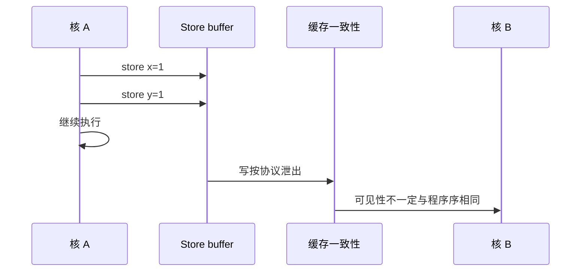

# 存储缓冲与内存序

单线程里，编译器与 CPU 都可重排无关操作，只要对当前线程的观测仍符合「仿佛按程序顺序」。多线程共享内存时，「仿佛按序」对每个核各自成立，并不自动给出全局唯一的写时间线。存储缓冲、无效队列与乱序执行让一个核的写延迟被另一核看见；语言内存模型与 CPU 内存模型规定哪些重排合法、哪些必须用屏障或原子禁止。口试里要把**数据竞争**和**竞态条件**分开，并说清乱序与 store buffer 为何需要序。

## 单核重排与 store buffer

核执行 store 时，常把写放入**存储缓冲（store buffer）**，不必等写穿透到缓存独占态就继续后面的指令。同核后续 load 同一地址通常可从 store buffer **转发**，自己看见自己的写。其他核在该写对缓存一致性协议变得可见之前，仍可读到旧值。因此「核 A 写了 `x=1` 再写 `y=1`」在核 B 上可能先看见 `y` 的新值再看见 `x` 的旧值——取决于硬件内存模型是否允许 store-store、store-load 等重排，以及是否插入了屏障。

Load 也可相对其他 load/store 重排（在弱序机器上更常见）。x86-64 的总存储序（TSO）较强：通常保留 store 顺序，允许的典型松弛是 store 后的 load 越过先前 store（store buffer 效应）。AArch64 更弱，需显式屏障或获取/释放语义的 load/store 来建立序。对照见 [x86-64 与 AArch64 对照](x86-vs-arm.md)。

## 硬件屏障与原子

屏障指令限制重排与缓冲泄出。例如「store 屏障」迫使先前 store 对一致性可见后再执行后续 store；「全屏障」更重。x86 上 `mfence`、带 `lock` 前缀的读改写、以及某些 `xchg` 具有强序效果；日常更多依赖 `lock` 附加的原子 RMW。AArch64 用 `dmb`/`dsb` 与 load-acquire / store-release 变体表达更细的序。

原子读改写（compare-and-swap、fetch-add）在硬件上往往附带对该地址的独占与序约束，用作锁与无锁结构的基元。它们解决的是「不可撕的更新 + 所需的可见序」；不自动消除 [高速缓存与局部性](cache.md) 中的伪共享——两个原子变量仍可落在同一行上互相踢行。

## 语言层：数据竞争与竞态条件

**数据竞争（data race）**：多线程并发访问同一内存位置，至少一次是写，且没有用语言定义的原子/同步机制排序。在 C++/Rust 等模型中，数据竞争通常是**未定义行为**——编译器可假设不存在，从而删除检查或跨线程重排普通 load/store。Java 对数据竞争给出较弱的「仍是同步破坏但有限」的语义，但仍不是正确并发写法。**竞态条件（race condition）**是更宽的正确性概念：结果依赖调度时序，即使每次访问都用了原子或锁，仍可能逻辑写错（TOCTOU、错误的锁粒度）。有数据竞争往往伴随竞态；无数据竞争仍可能有逻辑竞态。

happens-before（或等价的同步序）由锁的释放/获取、`join`、原子的 release/acquire、`volatile`（Java）等建立。没有这种边时，编译器可以把一个线程里的普通写挪过另一个看似无关的读——在单线程语义下合法，在你心里的「另一个线程当信号」用法下崩掉。

## 与流水线的关系

[CPU 流水线与乱序执行](cpu-pipeline.md) 说明单核如何乱序执行却按序提交。多核内存序回答的是：**已提交的写**以何种顺序对其他核变得可见，以及未使用同步时编译器允许怎样的重排。单核推测执行冲洗后的架构状态仍精确；跨核可见性不靠推测，靠一致性协议与缓冲泄出。把「乱序执行」直接说成「多核内存序」是混层：前者主要是单核吞吐机制，后者是共享内存的观测契约。

写并发代码时的落点：普通共享可变状态用互斥或等价同步；无锁路径显式选原子序（relaxed / acquire / release / seq_cst），并理解 x86 上许多序在降低时仍可能生成相同指令、换 AArch64 才露出 bug。第二章用具体原子指令与 `lock` 前缀接上；第四章 concurrency 页用语言模型收束。

!!! warning "基准与「加锁很慢」"

    高争用下，锁的主要开销通常是缓存行在核间弹跳与进入内核停服。低争用时，未争用的锁在 x86 上可能只需一次原子存储量级的开销。读数字时要标明争用程度与核数。
