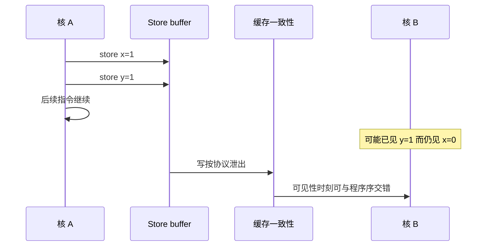

# 存储缓冲与内存序

单线程里，编译器与 CPU 都可重排无关操作，只要对当前线程的观测仍符合「仿佛按程序顺序」。多线程共享内存时，每个核各自的「仿佛按序」并不合成一条全局唯一的写时间线。存储缓冲、无效队列与乱序发射让一核对写的完成，与另一核看见该写的时刻脱节；硬件内存模型规定哪些脱节合法，语言内存模型再规定编译器可做哪些重排、何种访问算同步。口试第 7 题的落点是：说清 **store buffer 与乱序为何需要序**，并一句话分开 **数据竞争** 与 **竞态条件**。

## 单核：store buffer 与转发

核执行 store 时，通常先把写放入**存储缓冲（store buffer）**，不必等该缓存行进入独占态、写对一致性协议可见，就可以继续后续指令。同核稍后 load **同一地址**时，往往从 store buffer **转发**，自己立刻看见自己的写。其他核在该写泄出并完成一致性握手之前，仍可读到旧值。

因此「程序序上先写 `x` 再写 `y`」只约束本核对自身的观测；对他核而言，`y` 的新值完全可能先于 `x` 的新值出现——除非硬件模型禁止这类重排，或软件插入了屏障/释放语义的写。Load 相对其他 load/store 的重排在弱序 ISA 上更常见；即便在较强的模型里，**store 后跟一条无关地址的 load** 仍是最典型的松弛点，其微观原因正是 store 还停在 buffer 里，后面的 load 已经命中了本地缓存。

与 [CPU 流水线与乱序执行](cpu-pipeline.md) 的分工：流水线乱序解释的是单核如何重叠执行却按序提交架构状态；内存序解释的是**已提交的写**以何种规则对他核变得可见。把「乱序执行」直接说成「多核内存模型」是混层——前者主要是吞吐机制，后者是共享内存的观测契约。推测路径上的写在冲洗后不进入架构可见状态；跨核可见性靠一致性协议与缓冲泄出，不靠错误路径上的缓存副作用。

## 硬件模型：TSO 与弱序

**x86-64** 对普通 load/store 提供接近 **总存储序（TSO）** 的模型：store 之间的顺序通常保留；允许的典型松弛是 store-load，即后一条 load 越过仍在 store buffer 中的先写。许多在弱序机器上需要显式屏障的写法，在 x86 上「碰巧」正确，换 AArch64 才暴露。

**AArch64** 默认更弱：普通访问可发生更多种重排。建立序要靠屏障（`dmb`/`dsb` 等）或带 **acquire / release** 语义的 load/store 变体。对照见 [x86-64 与 AArch64 对照](x86-vs-arm.md)。

口头可用消息传递直觉：线程 A 写 `data`，再写 `flag=1`；线程 B 读到 `flag==1` 后读 `data`。若两处都是普通读写且无屏障，弱序机器上 B 可能看见 `flag==1` 而 `data` 仍是旧值。TSO 上 store-store 顺序通常仍在，但若中间夹了编译器重排，或 `flag` 的读与别的写之间缺少 acquire，仍可能错——故「硬件较强」不等于「语言层普通变量可当信号用」。

## 屏障与原子 RMW

**屏障（fence）**限制重排与缓冲泄出的种类：

| 意图 | 作用直觉 |
| --- | --- |
| StoreStore | 先前 store 对一致性可见后，才执行后续 store |
| LoadLoad | 先前 load 完成后，才执行后续 load |
| LoadStore / StoreLoad | 对应另外两种交叉；StoreLoad 通常最重，常要排空 store buffer |
| 全屏障 | 近似禁止跨越该点的所有上述重排 |

x86 上 `mfence` 是显式全屏障；带 `lock` 前缀的读改写、以及 `xchg` 等，往往附带强序效果。日常代码很少手写 `mfence`，更多依赖锁前缀原子 RMW 或编译器对原子内建的降级。AArch64 用 `dmb`/`dsb` 与 acquire/release 访问表达更细的序，代价与粒度更可见。

原子读改写（CAS、fetch-add、xchg）在硬件上对该地址取得独占并完成不可撕更新，同时按指令语义附带一定序约束。它们提供「更新不可撕 + 所需可见序」；不消除 [高速缓存与局部性](cache.md) 里的伪共享——两个原子变量仍可挤在同一缓存行上互相踢行。具体操作码与 `lock` 前缀在第二章 [原子指令与内存序指令](../ch02/atomics-x86.md) 展开。

## 语言内存模型与编译器重排

硬件模型约束的是**已生成的指令**在多核上的可见性。语言内存模型额外约束：

1. **编译器**可否把普通 load/store 挪过同步点、合并、删除；
2. 何种源构造建立 **happens-before**（或等价同步边）；
3. 违反规则时是 UB、是数据竞争下的弱保证，还是直接禁止编译。

没有同步边时，编译器可以把线程 A 里的 `data=…` 与 `flag=1` 对调，或把 `flag` 读出的值缓存进寄存器、不再去内存——在单线程 as-if 下合法，在「用普通变量当发布信号」的用法下崩溃。因此「CPU 是 TSO」挡不住「编译器先把你的序拆掉」。

常见降级关系（直觉，非完整规范）：

| 语言层概念 | 落到硬件时的粗映射 |
| --- | --- |
| 互斥锁 unlock / lock | 释放与获取；常生成屏障或带序的原子存取 |
| C++/Rust `memory_order_relaxed` | 原子性（不可撕）为主，几乎不建序 |
| `acquire` / `release` | 单向屏障；配对后形成 happens-before |
| `seq_cst` | 全序直觉更强；x86 上常仍是普通/带锁指令，弱序 ISA 上更重 |
| Java `volatile` | 近似 acquire/release + 可见性；与 C 的 `volatile`（禁止编译器优化该对象、不建多线程序）不是同一概念 |
| C `volatile` | 不对多线程同步；不能当便携内存屏障用 |

讨论 `atomic` / `volatile` 时，先问「哪门语言的哪条规则」，再问「降到本机 ISA 会变成什么指令」。导师清单里的 happens-before，指的就是这类同步边：锁的释放对获取、线程 `join`、发布-订阅的 release/acquire 等。无边则无跨线程的「我写完了你一定看见」承诺。

## 数据竞争与竞态条件

**数据竞争（data race）**：两个线程并发访问同一内存位置，至少一次是写，且该访问未经语言定义的原子或同步机制排序。定义随语言微调，但「冲突 + 并发 + 缺同步」这一骨架稳定。

- 在 **C++**（及相近的 LLVM 语言抽象）中，数据竞争是**未定义行为**：编译器可假设不存在，从而删除检查、跨线程重排普通访问。
- **Rust** 在安全子集里用类型系统拒绝数据竞争；`unsafe` 中的数据竞争仍按「不可接受 / 近 UB」处理。
- **Java** 对数据竞争给出的是较弱、但仍受 JMM 约束的语义（不是「任意 UB」），却仍不是正确写法；需要的是 `synchronized` / `volatile` / `java.util.concurrent` 原子类等。
- **Go** 的模型强调 happens-before；数据竞争可用 race detector 抓，规范上将其视为错误。

**竞态条件（race condition）**是更宽的**正确性**概念：程序结果依赖调度与时序，哪怕每一次内存访问都有原子或锁，仍可能逻辑错误——典型如 TOCTOU（先检查后使用之间状态已变）、锁粒度盖不住的不变量、两个原子变量之间缺少成对发布。

对照口试一句：

- 数据竞争：内存模型层面的非法（或未定义）并发访问形态；
- 竞态条件：算法/逻辑层面的时序敏感错误。

有数据竞争时常伴随竞态；**无数据竞争仍可有竞态**（两个 `AtomicBool` 配错协议就是例子）。把「我用了原子」说成「没有竞态」不成立；把「有竞态」说成「一定有数据竞争」也不成立。

## 写作与读基准时的落点

共享可变状态的默认路径是互斥或等价同步。无锁路径必须显式选择原子序，并在脑内跑一遍「发布端 release、订阅端 acquire」是否配对。x86 上把 acquire/release 降成 `relaxed` 仍可能通过测试；同一二进制逻辑移植到 AArch64 或换编译器版本才失败——这是内存序 bug 的典型画像。

高争用锁的成本往往是缓存行在核间弹跳与陷入内核，而不只是「多几条原子指令」。低争用下，未争用的锁在 x86 上可能接近一次原子存储量级。读并发基准时标明核数与争用；伪共享见 [高速缓存与局部性](cache.md)。第四章 concurrency 页用语言模型收束；第二章接具体原子指令。

!!! example "口试第 7 题答法提纲"

    （1）数据竞争是缺同步的冲突并发访问，在 C++ 等是 UB；竞态条件是时序导致的逻辑错误，有锁仍可能发生。（2）store 进入 store buffer 后本核可继续，他核暂时不见；乱序与缓冲使程序序 ≠ 全局可见序。（3）语言用 happens-before / 原子 / 锁约束编译器与降级后的屏障；硬件用 TSO 或弱序 + fence/acquire-release 约束指令观测。指回本页与第二章原子指令即可。
