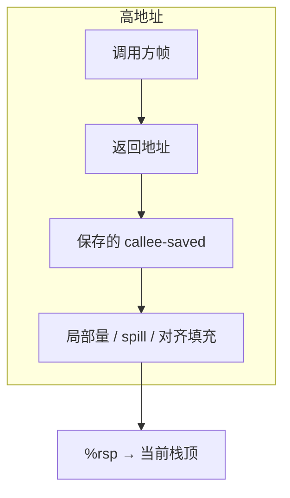

# 函数怎样互相调用


指令会写了之后，下一个卡住大多数人的地方是：一次函数调用在栈与寄存器上究竟发生了什么。编译器、手写汇编和 FFI 必须遵守同一份契约，否则参数会落在错误的位置。这一站建立口试里最常被追问的调用路径；启动与链接留到下一站。


一次 `call`/`ret` 在 ISA 层只保证返回地址的压入与弹出。局部变量、被保存寄存器、溢出槽以及对齐填充，由编译器或手写汇编在 `%rsp` 管理的栈区上排布，合称栈帧。本页描述 x86-64 上常见的 prologue/epilogue、局部量与 spill、红区，以及帧指针有无两种布局；寄存器级契约的完整表见 [SysV ABI](sysv-amd64-abi.md)。

### 调用瞬间的栈

执行 `call f` 时硬件完成：

1. `%rsp ← %rsp - 8`
2. 将返回地址（`call` 下一条指令的地址）写入 `(%rsp)`
3. `%rip ←` 目标地址

进入 `f` 首条指令时，`(%rsp)` 已是返回地址，且 `%rsp` 相对**调用前**下降了 8 字节。SysV 要求：**调用前** \(\texttt{rsp} \equiv 0 \pmod{16}\)；因此**被调函数入口处** \(\texttt{rsp} \equiv 8 \pmod{16}\)。prologue 里对 `%rsp` 的调整必须使下一次 `call` 之前重新满足 16 字节对齐。



读图顺序：从高地址的调用方帧向下，先看到 `call` 压入的返回地址，再进入被调方保存区与局部区；`%rsp` 指向当前栈顶（已用区域的低地址端）。若存在经栈传递的实参，它们位于返回地址**之上**（更高地址），属于调用方帧的一部分。

### Prologue 与 epilogue

带帧指针的经典形态（常见于 `-O0` 或显式 `-fno-omit-frame-pointer`）：

```asm
f:
    pushq   %rbp
    movq    %rsp, %rbp
    subq    $32, %rsp
    # ... 函数体：局部用 -8(%rbp) 等 ...
    leave                      # movq %rbp, %rsp; popq %rbp
    ret
```

建立帧指针之后：

| 地址 | 内容 |
| --- | --- |
| `8(%rbp)` | 返回地址 |
| `(%rbp)` | 保存的旧 `%rbp` |
| `-8(%rbp)` 等 | 局部量 / spill |
| `16(%rbp)` 起 | 经栈传入的实参（若有） |

省略帧指针时，prologue 只保存用到的 callee-saved 并 `subq` 调整 `%rsp`，局部量写成 `offset(%rsp)`。优化编译器输出多属此类；调试时局部变量的 DWARF 位置表达式往往依赖 CFA（canonical frame address）而非固定 `%rbp`。

保存 callee-saved 的典型片段：

```asm
f:
    pushq   %rbx
    pushq   %r12
    subq    $8, %rsp           # 对齐到下一次 call 前 rsp≡0 (mod 16)
    # 体：可安心使用 %rbx / %r12，并可再 call
    addq    $8, %rsp
    popq    %r12
    popq    %rbx
    ret
```

对齐算术：入口 \(\texttt{rsp} \equiv 8 \pmod{16}\)；两次 `push` 共减 16，仍为 \(\equiv 8\)；再 `subq $8` 得到 \(\equiv 0\)，满足再次 `call` 的前提。少减或多减 8 字节会把后续 `call` 推入错误对齐，表现为偶发的对齐敏感故障或 ABI 违规。

### 局部量与 spill

局部量是帧内固定槽位：标量、小结构体、必须取址的对象、以及保存跨越 `call` 的值。寄存器分配器在物理寄存器不够，或因 `&local`、别名、`setjmp` 等约束无法把值留在寄存器时，把内容**spill**到栈槽，需要时再 reload。

`-O0` 几乎为每个自动变量分配栈槽，prologue 末尾常能看见对槽的初始化存储。`-O2` 后许多局部只活在寄存器里，源码行与机器指令的对应变稀，调试器报告「已优化掉」即来源于此；第三章的 SSA 与 mem2reg 从 IR 侧解释同一现象。

需要取址的局部必须在内存中有稳定地址。这会迫使即使在高优化级别也为该类对象留帧空间，并可能抑制某些围绕该对象的优化。

变长数组与 `alloca` 在运行时移动 `%rsp`，固定 `offset(%rsp)` 随即失效，需经 `%rbp` 或另存的基址寄存器访问。此类函数通常不能依赖红区，unwind 表也更复杂。

### 红区

System V AMD64 为叶子函数保留 **红区（red zone）**：`%rsp` 下方 128 字节。在常规用户态约定下，信号投递不会把帧压进这块已由叶子函数使用的区域。叶子函数若不调用其他函数，可直接使用

```asm
leaf:
    movq    %rdi, -8(%rsp)
    # ... 用 -8(%rsp) 作临时 ...
    movq    -8(%rsp), %rax
    ret
```

而省略 `subq`/`addq`。一旦函数体内存在 `call`，被调方会把自己的帧（及红区使用）建在当前 `%rsp` 之下，原叶子假设不成立，必须显式分配帧。

红区是 ABI 对栈布局的补充约定，不是硬件特性。内核代码与 `-mno-red-zone`（常见于内核或中断上下文编译选项）关闭该假设。口试量规第 1 题要求陈述其大小、用途与「仅叶子」边界。

### 有帧指针与无帧指针的对照

| 项目 | 有 `%rbp` 帧 | 无帧指针 |
| --- | --- | --- |
| 局部寻址 | 稳定负偏移相对 `%rbp` | 相对 `%rsp`，随 push/call 变 |
| prologue 成本 | 多一次 push/mov | 更少指令 |
| 回溯 | 沿保存的 `%rbp` 链行走较直观 | 依赖 DWARF/`ORC` 等 unwind 信息 |
| 调试体验 | `-O0` 下变量位置稳定 | 优化构建下更常见 |

手写汇编若需要清晰的栈回溯或大量局部取址，保留帧指针往往更省事；追求与 `-O2` 编译器输出同构时，按省略帧指针的方式计算对齐与偏移。

### 经栈传递的实参

当前六个整数寄存器与八个 XMM 槽用尽后，额外实参由**调用方**写入栈。布局上，这些槽属于调用方帧：位于即将压入的返回地址的更高地址一侧。被调方在入口（尚未 `push %rbp` 时）可用 `8(%rsp)`、`16(%rsp)`… 读取（具体偏移取决于是否已有压栈）；建立 `%rbp` 后则常用 `16(%rbp)`、`24(%rbp)`…。

调用方负责在 `call` 返回后回收这些槽（通常只是在后续调整 `%rsp` 时一并加回）。SysV 不要求被调方用 `ret $imm` 清理，这与某些 stdcall 约定不同。阅读 `objdump` 时，若在 `call` 前看到对 `(%rsp)` 或 `disp(%rsp)` 的一串 `movq`，多半是在填第七个及以后的参数。

### 与返回值的衔接

`ret` 只恢复 `RIP`；返回值须在返回前按 ABI 写入约定寄存器（整数/指针在 `%rax`，多数浮点在 `%xmm0`）。epilogue 恢复 callee-saved 与 `%rsp` 的顺序必须与 prologue 严格镜像，否则调用方帧损坏通常表现为返回后立刻崩溃，而不是返回值错误。

把本页的帧图与下一页的寄存器表合起来，即可完整回答口试第 1 题：从 `call f` 到 `f` 首指令，栈上有什么、`%rsp` 模 16 余几、红区能否用、参数与返回值在哪些寄存器。自检时对着任意非叶子函数的反汇编，核对三点：入口后 `%rsp` 的净变化是否使下一次 `call` 前对齐；callee-saved 的 `push`/`pop` 是否成对；返回前 `%rax`/`%xmm0` 是否被写入预期结果。


栈帧是机制；SysV 把参数、返回值、保存责任写成平台约定。Linux 用户态 C 互操作默认它。


System V AMD64 ABI 规定 Linux、macOS、BSD 等平台上用户态 C 语言级过程调用的寄存器分工、栈约束与聚合类型传递规则。ISA 只提供 `call`/`ret` 与寄存器；哪些寄存器传第几个参数、谁负责保存、入口处栈如何对齐，全部由本约定约束。口试量规第 1 题的完整答案落在本页与 [栈帧](stack-frames.md)。

下文「整数」含指针与 \(\leq 64\) 位整数；浮点指经 SSE 传递的标量（如 `float`/`double`）。复杂聚合的完整分类算法以规范原文为准，此处给出口试与读汇编所需的工作模型。

### 整数与指针参数

前六个整数/指针参数依次放入：

| 序号 | 寄存器 |
| --- | --- |
| 1 | `%rdi` |
| 2 | `%rsi` |
| 3 | `%rdx` |
| 4 | `%rcx` |
| 5 | `%r8` |
| 6 | `%r9` |

第七个及以后的整数参数由调用方写入栈上，每个占 8 字节槽（不足 8 字节的类型对齐提升到槽宽）。调用方在 `call` 之前完成写入；被调方用正偏移相对入口 `%rsp` 或帧指针读取。

窄于 32 位的类型在寄存器中以扩展后的形式呈现：调用方负责按类型做符号扩展或零扩展。手写汇编调用 C 函数时，应对齐这一扩展约定，避免高位垃圾影响被调方。

### 返回值

| 类型 | 位置 |
| --- | --- |
| \(\leq 64\) 位整数/指针 | `%rax` |
| 128 位整数（如 `__int128`） | `%rdx:%rax`（高：低） |
| 浮点/多数标量 SSE | `%xmm0`（更宽可再及 `%xmm1`） |
| 内存返回的结构体 | 由调用方提供隐藏指针，见下文 |

`void` 无返回值寄存器约定。返回后调用方保存的 caller-saved 寄存器内容视为已失，须在调用前自行保存需要的值。

### 栈对齐与红区

**对齐**：在执行 `call` **之前**，`%rsp` 必须满足

\[
\texttt{rsp} \equiv 0 \pmod{16}
\]

`call` 压入 8 字节返回地址后，被调方入口处 \(\texttt{rsp} \equiv 8 \pmod{16}\)。被调方若还要再 `call`，prologue 对 `%rsp` 的净调整须使下一次调用前重新回到 \(\equiv 0 \pmod{16}\)。含有 SSE/AVX 对齐访存或宽类型栈槽时，编译器可能把对齐提到 32/64 字节；口试默认先答 16。

**红区**：`%rsp` 下方 128 字节供**叶子函数**直接存放临时数据而无需修改 `%rsp`。非叶子函数、内核路径、`-mno-red-zone` 编译单元不使用该假设。信号投递约定保证普通用户态叶子红区不被信号帧覆盖；细节边界见 [栈帧](stack-frames.md) 与 [信号](exceptions-signals.md)。

### 调用者保存与被调用者保存

| 类别 | 寄存器 | 责任 |
| --- | --- | --- |
| 调用者保存 | `%rax` `%rcx` `%rdx` `%rsi` `%rdi` `%r8` `%r9` `%r10` `%r11`；`%xmm0`–`%xmm15` | 被调方可任意破坏；调用方跨 `call` 需要则自存 |
| 被调用者保存 | `%rbx` `%rbp` `%r12` `%r13` `%r14` `%r15` | 被调方使用前保存、返回前恢复 |
| 特立 | `%rsp` | 返回时必须恢复到调用方期望的值（与 prologue 镜像） |

`%r10`/`%r11` 为调用者保存，常作静态链、PLT 解析临时等；不参与前六个参数槽。整数参数寄存器与返回值寄存器同属调用者保存集合，与「传参」和「易失」两套标签同时成立。

从 `call f` 到 `f` 首指令的叙述：

1. 调用方把参数写入 `%rdi`… 与必要时的栈槽，并保证 \(\texttt{rsp} \equiv 0 \pmod{16}\)。
2. `call` 压入返回地址，转入 `f`；此时 \(\texttt{rsp} \equiv 8 \pmod{16}\)，`(%rsp)` 为返回地址。
3. `f` 若破坏 callee-saved，须先保存；叶子可用红区，非叶子先调整 `%rsp`。
4. 返回值写入 `%rax`/`%xmm0` 等；epilogue 恢复 `%rsp` 与 callee-saved；`ret` 弹出返回地址。

### 浮点与 XMM 参数

标量浮点参数按出现顺序依次使用 `%xmm0`–`%xmm7`；用尽后走栈。整数寄存器与 XMM 寄存器**分别计数**：`void g(double a, long b, double c)` 中 `a→%xmm0`，`b→%rdi`，`c→%xmm1`。

两个 `double` 参数分别在 `%xmm0` 与 `%xmm1`。混有整数时，浮点不占用 `%rdi`/`%rsi` 槽位。

返回的标量浮点在 `%xmm0`。向量类型与 AVX 宽度另有分类；读汇编时以编译器实际选用的 `xmm`/`ymm` 为准。

### 变参与 `%al`

对可变参数函数（如 `printf`），调用方还须在 `%al` 中放入**本调用实际使用的 XMM 参数寄存器个数**（0–8）。被调方序言可能按 `%al` 决定是否把 XMM 寄存器溢出到寄存器保存区，以便 `va_list` 统一遍历。

```asm
    # 调用 printf("%f %ld\n", x, n) 的轮廓
    # %xmm0 = x, %rsi = n, %rdi = 格式串
    movb    $1, %al            # 用了 1 个 XMM 参数
    call    printf
```

固定参数函数的 `%al` 无此义务；变参调用若未设置 `%al`，在部分实现上表现为浮点变参错乱。

### 结构体与聚合返回

聚合分类的工作模型：

- 总尺寸 \(\leq 16\) 字节且字段可归入整数/SSE 类时，常拆入 `%rax`/`%rdx` 或 `%xmm0`/`%xmm1`（或混合）。
- 更大或需「内存类」的结构体：调用方分配返回槽，将其地址作为**隐藏首个参数**传入（占用 `%rdi`，用户可见参数顺延），被调方把结果写入该地址；此时 `%rax` 常回传同一指针。

```c
struct Big { long a, b, c, d; };
struct Big h(void);
```

对应调用方轮廓：在栈上留出 `sizeof(struct Big)` 对齐空间，`%rdi` = 该地址，再 `call h`。读 `objdump` 时若见到「多出一个指针参数」且 C 源只有返回结构体，即是该机制。

参数方向的小结构体按字段拆分进可用的整数/XMM 寄存器；拆分失败则整颗入栈。精确到每个字段的八字节分类以 ABI 文档的 ALGORITHM 为准；能陈述「\(\leq 16\) 可走寄存器、更大走隐藏指针」即可定位大多数反汇编现象。

### 口试叙事示例

给定：

```c
double h(double x, double y, long n);
```

调用方在 `call h` 之前：`%xmm0=x`，`%xmm1=y`，`%rdi=n`，且 \(\texttt{rsp} \equiv 0 \pmod{16}\)。`call` 压入返回地址后进入 `h`，此时 \(\texttt{rsp} \equiv 8 \pmod{16}\)，`(%rsp)` 为返回地址。若 `h` 为叶子并只用红区与 caller-saved 寄存器，可无 `subq`；若 `h` 还调用别人，须调整 `%rsp` 并保存用到的 callee-saved。返回时标量结果在 `%xmm0`，`ret` 弹出返回地址。把这一段与 [栈帧](stack-frames.md) 的图合说，即覆盖口试量规第 1 题的主干。

再对照整数版 `long f(long a, long b)`：参数在 `%rdi`/`%rsi`，返回在 `%rax`；其余栈对齐与保存责任相同。浮点与整数寄存器分别编号：混传时各自从 `%xmm0`、`%rdi` 起算，互不挤占对方的槽位。

### 与调用相关的其余约定

线程局部访问属于 ABI 的延伸，见 [TLS](tls.md)。系统调用使用另一套寄存器约定（`%rax` 为号，参数在 `%rdi`…`%r9`，经 `syscall` 指令陷入内核），与用户态 `call` 分立：不压返回地址到用户栈，返回地址在 `RCX`（`syscall` 硬件行为），`R11` 保存 `RFLAGS`；详见 [系统调用路径](syscalls.md)。

### AArch64 AAPCS64 对照

AArch64 过程调用标准（AAPCS64）与 SysV AMD64 同属「寄存器传参 + 栈对齐」家族，具体映射不同。对照轴是参数寄存器、返回值、栈约束与保存责任。

| 项目 | SysV AMD64 | AAPCS64 |
| --- | --- | --- |
| 整数参数 | `%rdi` `%rsi` `%rdx` `%rcx` `%r8` `%r9` | `x0`–`x7` |
| 浮点参数 | `%xmm0`–`%xmm7` | `v0`–`v7`（或 `d0`–`d7` 视图） |
| 整数返回 | `%rax`（次 `%rdx`） | `x0`（次 `x1`） |
| 浮点返回 | `%xmm0` | `v0` |
| 调用前栈对齐 | 16 字节 | 16 字节 |
| 红区 | 128 字节，叶子可用 | 无同名 128 字节用户红区约定；临时空间显式分配 |
| 被调用者保存 | `%rbx` `%rbp` `%r12`–`%r15` | `x19`–`x28`；`sp`；部分向量寄存器 |
| 调用者保存 | 其余通用与 XMM | `x0`–`x18` 等（含临时与参数）；细节见规范 |
| 变参 | `%al` = 使用的 XMM 数 | 经寄存器保存区/栈统一遍历，无 `%al` 同位物 |
| 大结构体返回 | 隐藏指针占首个参数寄存器 | 同类：间接结果位置寄存器 |

AArch64 的 `blr`/`ret` 用链接寄存器 `x30`（`lr`）保存返回地址，返回地址默认**不**压栈；需要时由被调方将 `lr` 存入栈帧。这与 x86-64 `call` 隐式压栈形成最显著的控制流差别：读 AArch64 反汇编时，prologue 的 `stp x29, x30, [sp, #-...]!` 一类指令同时保存帧指针与返回地址。

本站后续 ELF、PIC、syscall 主线仍以 x86-64 SysV 为准；遇到 AArch64 对象时，用本表替换寄存器名，并记住返回地址在 `lr` 而非栈顶。
