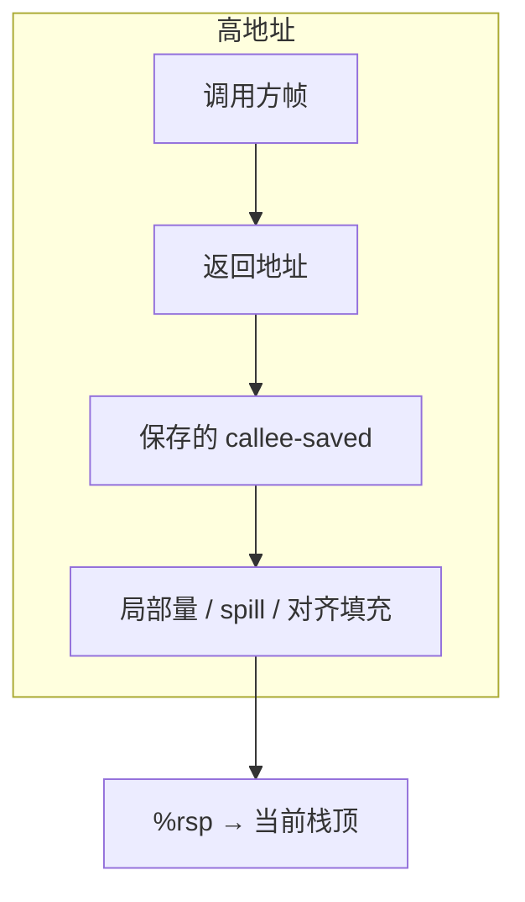

# 过程调用与栈帧

一次 `call`/`ret` 在 ISA 层只保证返回地址的压入与弹出。局部变量、被保存寄存器、溢出槽以及对齐填充，由编译器或手写汇编在 `%rsp` 管理的栈区上排布，合称栈帧。本页描述 x86-64 上常见的 prologue/epilogue、局部量与 spill、红区，以及帧指针有无两种布局；寄存器级契约的完整表见 [SysV ABI](sysv-amd64-abi.md)。

## 调用瞬间的栈

执行 `call f` 时硬件完成：

1. `%rsp ← %rsp - 8`
2. 将返回地址（`call` 下一条指令的地址）写入 `(%rsp)`
3. `%rip ←` 目标地址

进入 `f` 首条指令时，`(%rsp)` 已是返回地址，且 `%rsp` 相对**调用前**下降了 8 字节。SysV 要求：**调用前** \(\texttt{rsp} \equiv 0 \pmod{16}\)；因此**被调函数入口处** \(\texttt{rsp} \equiv 8 \pmod{16}\)。prologue 里对 `%rsp` 的调整必须使下一次 `call` 之前重新满足 16 字节对齐。



读图顺序：从高地址的调用方帧向下，先看到 `call` 压入的返回地址，再进入被调方保存区与局部区；`%rsp` 指向当前栈顶（已用区域的低地址端）。若存在经栈传递的实参，它们位于返回地址**之上**（更高地址），属于调用方帧的一部分。

## Prologue 与 epilogue

带帧指针的经典形态（常见于 `-O0` 或显式 `-fno-omit-frame-pointer`）：

```asm
f:
    pushq   %rbp
    movq    %rsp, %rbp
    subq    $32, %rsp
    # ... 函数体：局部用 -8(%rbp) 等 ...
    leave                      # movq %rbp, %rsp; popq %rbp
    ret
```

建立帧指针之后：

| 地址 | 内容 |
| --- | --- |
| `8(%rbp)` | 返回地址 |
| `(%rbp)` | 保存的旧 `%rbp` |
| `-8(%rbp)` 等 | 局部量 / spill |
| `16(%rbp)` 起 | 经栈传入的实参（若有） |

省略帧指针时，prologue 只保存用到的 callee-saved 并 `subq` 调整 `%rsp`，局部量写成 `offset(%rsp)`。优化编译器输出多属此类；调试时局部变量的 DWARF 位置表达式往往依赖 CFA（canonical frame address）而非固定 `%rbp`。

保存 callee-saved 的典型片段：

```asm
f:
    pushq   %rbx
    pushq   %r12
    subq    $8, %rsp           # 对齐到下一次 call 前 rsp≡0 (mod 16)
    # 体：可安心使用 %rbx / %r12，并可再 call
    addq    $8, %rsp
    popq    %r12
    popq    %rbx
    ret
```

对齐算术：入口 \(\texttt{rsp} \equiv 8 \pmod{16}\)；两次 `push` 共减 16，仍为 \(\equiv 8\)；再 `subq $8` 得到 \(\equiv 0\)，满足再次 `call` 的前提。少减或多减 8 字节会把后续 `call` 推入错误对齐，表现为偶发的对齐敏感故障或 ABI 违规。

## 局部量与 spill

局部量是帧内固定槽位：标量、小结构体、必须取址的对象、以及保存跨越 `call` 的值。寄存器分配器在物理寄存器不够，或因 `&local`、别名、`setjmp` 等约束无法把值留在寄存器时，把内容**spill**到栈槽，需要时再 reload。

`-O0` 几乎为每个自动变量分配栈槽，prologue 末尾常能看见对槽的初始化存储。`-O2` 后许多局部只活在寄存器里，源码行与机器指令的对应变稀，调试器报告「已优化掉」即来源于此；第三章的 SSA 与 mem2reg 从 IR 侧解释同一现象。

需要取址的局部必须在内存中有稳定地址。这会迫使即使在高优化级别也为该类对象留帧空间，并可能抑制某些围绕该对象的优化。

变长数组与 `alloca` 在运行时移动 `%rsp`，固定 `offset(%rsp)` 随即失效，需经 `%rbp` 或另存的基址寄存器访问。此类函数通常不能依赖红区，unwind 表也更复杂。

## 红区

System V AMD64 为叶子函数保留 **红区（red zone）**：`%rsp` 下方 128 字节。在常规用户态约定下，信号投递不会把帧压进这块已由叶子函数使用的区域。叶子函数若不调用其他函数，可直接使用

```asm
leaf:
    movq    %rdi, -8(%rsp)
    # ... 用 -8(%rsp) 作临时 ...
    movq    -8(%rsp), %rax
    ret
```

而省略 `subq`/`addq`。一旦函数体内存在 `call`，被调方会把自己的帧（及红区使用）建在当前 `%rsp` 之下，原叶子假设不成立，必须显式分配帧。

红区是 ABI 对栈布局的补充约定，不是硬件特性。内核代码与 `-mno-red-zone`（常见于内核或中断上下文编译选项）关闭该假设。约定规定红区大小、用途，以及通常仅叶子函数依赖它。

## 有帧指针与无帧指针的对照

| 项目 | 有 `%rbp` 帧 | 无帧指针 |
| --- | --- | --- |
| 局部寻址 | 稳定负偏移相对 `%rbp` | 相对 `%rsp`，随 push/call 变 |
| prologue 成本 | 多一次 push/mov | 更少指令 |
| 回溯 | 沿保存的 `%rbp` 链行走较直观 | 依赖 DWARF/`ORC` 等 unwind 信息 |
| 调试体验 | `-O0` 下变量位置稳定 | 优化构建下更常见 |

手写汇编若需要清晰的栈回溯或大量局部取址，保留帧指针往往更省事；追求与 `-O2` 编译器输出同构时，按省略帧指针的方式计算对齐与偏移。

## 经栈传递的实参

当前六个整数寄存器与八个 XMM 槽用尽后，额外实参由**调用方**写入栈。布局上，这些槽属于调用方帧：位于即将压入的返回地址的更高地址一侧。被调方在入口（尚未 `push %rbp` 时）可用 `8(%rsp)`、`16(%rsp)`… 读取（具体偏移取决于是否已有压栈）；建立 `%rbp` 后则常用 `16(%rbp)`、`24(%rbp)`…。

调用方负责在 `call` 返回后回收这些槽（通常只是在后续调整 `%rsp` 时一并加回）。SysV 不要求被调方用 `ret $imm` 清理，这与某些 stdcall 约定不同。阅读 `objdump` 时，若在 `call` 前看到对 `(%rsp)` 或 `disp(%rsp)` 的一串 `movq`，多半是在填第七个及以后的参数。

## 与返回值的衔接

`ret` 只恢复 `RIP`；返回值须在返回前按 ABI 写入约定寄存器（整数/指针在 `%rax`，多数浮点在 `%xmm0`）。epilogue 恢复 callee-saved 与 `%rsp` 的顺序必须与 prologue 严格镜像，否则调用方帧损坏通常表现为返回后立刻崩溃，而不是返回值错误。

把本页的帧图与下一页的寄存器表合起来，核对：从 `call f` 到 `f` 首指令，栈上有什么、`%rsp` 模 16 余几、红区能否用、参数与返回值在哪些寄存器。自检时对着任意非叶子函数的反汇编，核对三点：入口后 `%rsp` 的净变化是否使下一次 `call` 前对齐；callee-saved 的 `push`/`pop` 是否成对；返回前 `%rax`/`%xmm0` 是否被写入预期结果。
