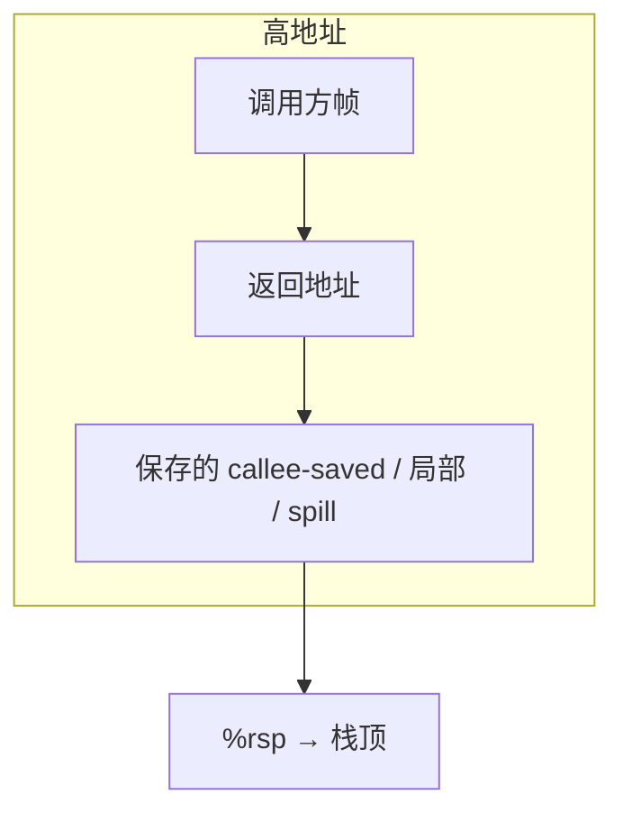

# 过程调用与栈帧

一次 `call`/`ret` 在 ISA 层只保证返回地址的压入与弹出。局部变量、被保存寄存器、溢出槽以及对齐填充，由编译器或手写汇编在 `%rsp` 管理的栈区上排布，合称栈帧。本页描述 x86-64 上常见的 prologue/epilogue 形态、局部量与 spill，以及 System V 叶子函数可用的红区；寄存器级契约见 [SysV ABI](sysv-amd64-abi.md)。

## 调用瞬间的栈

执行 `call f` 时硬件完成：

1. `%rsp ← %rsp - 8`
2. 将返回地址（`call` 下一条指令的地址）写入 `(%rsp)`
3. `%rip ←` 目标地址

进入 `f` 首条指令时，`(%rsp)` 已是返回地址，且 `%rsp` 相对**调用前**下降了 8 字节。SysV 要求：**调用前** `%rsp` ≡ 0 (mod 16)；因此**被调函数入口处** `%rsp` ≡ 8 (mod 16)。prologue 里对 `%rsp` 的调整必须使下一次 `call` 之前重新满足 16 字节对齐。



读图顺序：从高地址的调用方帧向下，先看到 `call` 压入的返回地址，再进入被调方分配的区域；`%rsp` 始终指向当前栈顶（最低已用地址一侧）。

## Prologue 与 epilogue

带帧指针的经典形态（常见于 `-O0`）：

```asm
f:
    pushq   %rbp
    movq    %rsp, %rbp
    subq    $32, %rsp          # 局部与对齐
    # ... 函数体 ...
    leave                      # 等价 movq %rbp,%rsp; popq %rbp
    ret
```

`pushq %rbp` 再把 `%rbp` 设为当前 `%rsp` 后，旧帧指针位于 `(%rbp)`，返回地址位于 `8(%rbp)`，局部量常用 `-offset(%rbp)` 寻址。参数若经栈传递，出现在 `16(%rbp)` 起（本约定下前六个整数参数在寄存器里）。

省略帧指针时，prologue 只保存用到的 callee-saved 寄存器并调整 `%rsp`，局部量全部写成 `offset(%rsp)`；中间若有 `push`/`pop` 或 `call`，偏移需按实时 `%rsp` 计算。优化编译器输出多属此类。

保存 callee-saved 的典型片段：

```asm
f:
    pushq   %rbx
    pushq   %r12
    subq    $8, %rsp           # 使 RSP 在下一次 call 前 16 字节对齐
    # 使用 %rbx / %r12 ...
    addq    $8, %rsp
    popq    %r12
    popq    %rbx
    ret
```

对齐算术：入口 `%rsp ≡ 8 (mod 16)`；两次 `push` 使 `%rsp ≡ 8 - 16 ≡ 8 (mod 16)` 仍为 8；再 `subq $8` 得到 `%rsp ≡ 0 (mod 16)`，满足再次 `call` 的前提。少减或多减 8 字节是手写汇编里栈破坏的常见来源。

## 局部量与 spill

局部量是帧内固定槽位：标量、小结构体、保存跨调用的值。编译器在寄存器分配失败或值必须取址（`&local`）时，把寄存器内容**spill**到栈槽，需要时再 reload。`-O0` 几乎每个变量都有栈槽；`-O2` 后许多局部只活在寄存器里，断点处「变量已优化掉」即来源于此。

需要取址的局部必须在栈上（或堆上）有地址；寄存器没有稳定地址。这会迫使编译器即使在高优化级别也为该类对象分配帧空间。

变长数组或 `alloca` 在运行时移动 `%rsp`，此后固定偏移寻址失效，需经帧指针或保存基址的寄存器访问。与固定帧相比，这类函数对红区与 unwind 信息更敏感。

## 红区

System V AMD64 为叶子函数保留 **红区（red zone）**：`%rsp` 下方 128 字节的区域，信号处理器与中断不会破坏其中由用户态叶子函数写入的内容（在常规用户态约定下）。叶子函数若不调用其他函数，可直接使用

```asm
    movq    %rax, -8(%rsp)     # 使用红区，无需 subq
```

存放临时值，省略 `subq`/`addq`。一旦函数内存在 `call`，被调方（及之后的逻辑）会认为 `%rsp` 以下可随意使用，红区不再安全，必须显式分配帧。内核代码、`-mno-red-zone`（如某些内核/中断路径编译选项）下红区关闭，不可沿用用户态叶子优化。

红区是 ABI 对栈布局的补充约定，不是硬件特性；与对齐、callee-saved 一样，属于软件契约。口试量规第 1 题要求能陈述其存在与「仅叶子安全」的边界，细节表见下一页。

## 与返回值的衔接

`ret` 只恢复 `RIP`；返回值须在返回前按 ABI 写入约定寄存器（整数/指针在 `%rax`，多数浮点在 `%xmm0`）。epilogue 恢复 callee-saved 与 `%rsp` 的顺序必须与 prologue 严格镜像，否则调用方帧损坏表现为「返回后崩溃」而非「返回值错误」。下一页把参数寄存器、保存责任、浮点与变参、结构体返回收成一张可背诵的契约表。
