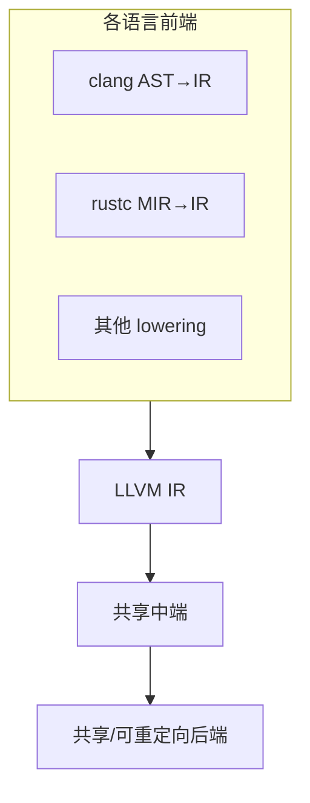

# 生成机器码与对着调试

后端把 IR 变成具体 CPU 上的指令：选择操作码、分配物理寄存器、按 ABI 排列参数，并生成 DWARF 等调试信息。`-O2` 下断点对不上源码行时，原因通常在优化与调试信息这两侧。

### 指令选择

LLVM IR 的一条 `add i32` 在 x86-64 上可能对应 `addl`、`leaq` 折出的加法，或与内存操作数折叠后的单指令。指令选择（instruction selection）在 IR 或前期机器指令上匹配模式，选出代价可接受的机器指令组合。经典路线包括树模式匹配（把表达式树盖住）与基于 DAG 的选择；现代后端还常在 MachineInstr / Machine IR 层做窥孔与伪指令展开。

选择阶段要遵守目标约束：哪些立即数能编码进指令、哪些运算需要先把值搬进特定寄存器类、SIMD 与标量路径如何切换。非法组合会在后续合法化（legalize）步骤被拆开或替换成库调用。读 `-O2` 汇编时看到的「把两条 IR 合成一条 lea」或「把 `mul` 变成移位」，多半来自选择与相关机器通道。

### 寄存器分配

IR/SSA 里名字几乎无限；CPU 只有几十个通用寄存器，且调用约定还划走一部分。寄存器分配（register allocation）为每个存活区间指定物理寄存器，或在不够用时插入 spill/reload（把值存到栈槽再载回）。分配器依赖活跃变量分析与干涉图（或基于线性扫描的近似）：同一时刻活着的值不能共享同一寄存器。

SSA 在分配前通常要消解 φ：在前驱块末尾插入拷贝或等价的数据移动，使合流处变成普通机器移动。callee-saved 寄存器若被用到，分配结果必须在函数序言/尾声生成保存与恢复；caller-saved 跨调用的存活值必须被存到栈上或改用 callee-saved——这与 [调用约定在 LLVM 中的落地](llvm-calling-conv.md) 直接相连。

spill 一多，`-O2` 的「寄存器里转」优势会被内存流量吃掉；反之，`-O0` 常故意少做分配、大量用栈槽，换取调试时变量位置稳定。同一函数在两种优化等级下的 `objdump` 对照见 [从 C 到 LLVM IR 到目标码](c-to-asm-lab.md)。

### 机器相关收尾

分配之后还有帧索引消除、分支放松、字面量池与对齐、EH/unwind 表发射等。输出可以是汇编文本（再交给 `as`）或直接写目标文件。从「还能叫 IR」到「已经是目标码」的边界因后端实现而异；对话时抓住 **isel → RA → 发射** 三段即可。

!!! note "TableGen 与描述驱动后端"

    LLVM 目标后端大量用 **TableGen**（`.td` 文件）描述指令格式、寄存器类、调度模型与选择模式，再生成 C++ 表与匹配代码。本章只需知道其存在与用途；改指令编码或寄存器类时才会深入。

调用约定规定参数与返回值放在哪些寄存器或栈槽、谁保存哪些寄存器、入口栈如何对齐。LLVM IR 里的 `call` 仍使用虚拟形态；真正按 [System V AMD64 ABI](../ch02/sysv-amd64-abi.md)（或 Windows x64、AAPCS64 等）排布，发生在后端 lowering 与指令发射阶段。前端负责选出正确的约定属性；后端负责生成遵守该约定的序言、实参移动与 `call`/`ret` 序列。

### IR 上的调用形态

一条典型调用：

```llvm
%rv = call i32 @foo(i32 %a, ptr %p)
```

这里只固定了类型与实参值的 SSA 名，没有写「`%a` 进 `%edi`」。函数定义与调用点可以带 **calling convention** 标识（如 `ccc` 表示 C 默认约定，`fastcc`、`tailcc`、`webkit_jscc` 等表示其他约定），以及参数属性：`zeroext` / `signext`、`byval`、`sret`、`inreg`、`align` 等。这些属性把 ABI 里「窄整数如何扩展」「结构体走隐藏指针还是拆寄存器」提前说清楚，供后端选对移动指令。

返回 `sret` 结构体时，IR 常表现为额外的指针参数；前端按目标 ABI 决定是否使用该形式。变参函数还需在约定要求时生成「浮点参数个数」一类信息（SysV 下对应 `%al`），具体由前端与目标 lowering 协作完成。

### 从 call 到机器码

后端在指令选择前后把每个实参放到 ABI 指定位置：前几个整数进 `%rdi`…`%r9`，多余的进栈，浮点进 `%xmm0`…。跨 `call` 仍存活的 caller-saved 值被存到栈槽或改放 callee-saved 寄存器。被调函数若使用 `%rbx` 等，序言 push、尾声 pop。栈对齐（SysV 下 `call` 前 `%rsp ≡ 0 (mod 16)`）由帧 lowering 与调用序列共同保证。

尾调用在约定与目标支持时，可生成不增长栈的跳转式调用；IR 上的 `musttail` / `tail` 标记表达前端意图，后端再决定能否兑现。读汇编时看到的 `jmp` 代替 `call`，往往对应这一路径。

### 与语言前端的交界

C/clang 默认 `ccc`，与平台 C ABI 对齐，便于与手写汇编、其他 C 目标文件互链。Rust、Swift 等对内部函数可能使用更快的私有约定，在对外 `extern "C"` 边界再切回 C ABI；这种切换表现为不同函数上的约定属性，由前端显式标出。异常与人格（personality）相关的调用（`invoke`）还要与 unwind 表一致，细节超出本页，但同样属于「约定 + 运行时」而不只是寄存器表。

[SysV 寄存器表](../ch02/sysv-amd64-abi.md) 回答「机器上怎么传」；本页回答「LLVM 如何在 IR 属性里声明、在后端落实」；[语言语义边界](llvm-semantics-limits.md) 回答「别名等非布局类信息如何另附」。

LLVM 是 IR、优化通道与可重定向后端的共享库集合；完整语言编译器还要自带前端。语言前端负责词法到语义，再把合法程序 **lowering** 成 LLVM IR（内存中的 `Module`，或文本/位码）；之后可调用同一套 `opt` 通道与 `llc`/目标机器发射。不同语言的差异主要停在「如何生成 IR」。

### clang

clang 是 C/C++/Objective-C 的官方 LLVM 前端。预处理与语法/语义在 clang 侧完成；CodeGen 遍历 AST，发射函数、全局量、调试元数据与 TBAA 等。用户命令 `clang -emit-llvm` 停在 IR；默认链接驱动则继续跑中端与后端，再调系统汇编器/链接器。C 的 UB 边界、`restrict`、有符号溢出等，在 CodeGen 时变成 `nsw`/`nuw`、`noalias` 等，见 [语言语义在 LLVM 边界上的损失](llvm-semantics-limits.md)。

同一驱动也负责选择目标三元组、CPU 特性与优化等级，把 `-O2` 映射到一组 pass pipeline。clang = 语言前端 + 对 LLVM API 的驱动；「LLVM」一词有时被口语用来指整条 clang 管线，技术上应区分前后端归属。

### rustc 与其他接入方式

**rustc** 在 Mir 等语言 IR 上完成借用检查与大量 Rust 专用变换，再通过 LLVM 后端（或实验性替代后端）发射目标码。对外 `extern "C"` 的函数按 C ABI 生成；Rust 内部符号可采用不同约定与名字修饰。因此「Rust 程序里的一次调用」是否遵守 SysV，取决于该函数在 FFI 边界的哪一侧。

历史上 **Swift**、部分 **Julia**、**Zig**、**Haskell**（GHC LLVM 后端）等也曾或仍在使用 LLVM 做代码生成。接入模式大致三种：链上官方库生成 IR；写位码/IR 文本再喂给 `llc`；或嵌入 ORC/MCJIT 做运行时编译。共同前提是：前端已解决类型与安全策略，交给 LLVM 的是「足够低、足够显式」的操作。



### 前端仍必须自己做的事

内存管理策略（RC、GC、手工 `free`）、对象模型、泛型单态化或擦除、方法派发、与运行时库的约定，仍由前端与运行时决定。GC 语言需配合 safepoint、stack map 或非 LLVM 运行时；LLVM 提供挂钩点。调试信息、行号与变量位置由前端插入 DI 元数据，后端再写成 DWARF 等，见 [调试信息与 DWARF](debug-dwarf.md)。语言语义与诊断在前端结束；跨语言可共享的优化与机器码生成从 LLVM IR 开始。

调试信息把机器码位置、源级类型与变量位置关联起来，使断点、单步与打印局部量成为可能。在 ELF 工具链上，这些信息通常以 **DWARF** 节（`.debug_info`、`.debug_line`、`.debug_loc` / `.debug_loclists` 等）存在于目标文件与可执行文件中；剥离（`strip`）后程序仍可跑，调试器则失去源级视图。

### 调试信息的生成

前端在生成 IR 时插入调试元数据：源文件、行列、变量名与类型、词法块。LLVM 后端把元数据降到 DWARF 记录，并随指令调度更新「当前 PC 对应哪一行」「变量现在在哪个寄存器或栈槽」。`-g` 打开生成；优化等级决定位置信息能有多密——`-O0 -g` 最接近「一行源码对一块指令、变量多在栈上」；`-O2 -g` 仍可调试，但变量常显示为 `<optimized out>`，因为值被合并、拆分或只在短存活区间存在于寄存器。

这与 [SSA](ssa.md) 里 mem2reg 之后「源级名字不再对应单一栈槽」是同一现象的调试面：优化合法地改变了存储位置，调试器按 DWARF 位置列表如实报告「此处没有该变量的位置」。

### 读调试节的最小操作

```bash
clang -O0 -g -c -o f.o f.c
llvm-dwarfdump f.o          # 或 readelf --debug-dump=
objdump -d f.o
```

对照 `.debug_line` 的行号程序与反汇编地址，可以指认某条 `movl` 对应源码哪一行。优化后再编译一份，看同一变量的 location 是否从 `DW_OP_fbreg`（帧相对栈槽）变成寄存器或缩短区间。

更细的 DWARF 表达式与压缩格式随版本变化。调试体验依赖元数据；优化与调试信息可以共存，但源级状态与机器状态的一一对应会变稀。端到端对照步骤见 [从 C 到 LLVM IR 到目标码](c-to-asm-lab.md)。
