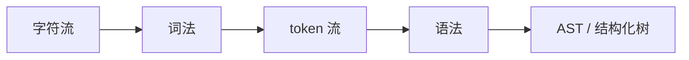

# 前端：词法与语法

编译器前端把字符流变成带结构的语法树（或等价的结构化表示）。词法分析切出 token；语法分析按文法规则把 token 序列归约成表达式、语句、声明等节点。这一阶段几乎不涉及目标 ISA；它决定的是「源码在语言文法下的形状」，供后续语义分析与 lowering 使用。

## 词法分析

词法器读入源文件字符，按最长匹配或语言规定的规则吐出 token 流：关键字、标识符、字面量、运算符、标点。空白与多数注释在这一层被丢弃（或只留下调试用位置信息）。预处理语言（如 C）往往在真正词法之前还有宏展开与 `#include` 拼接；展开后的字符流才进入常规 lexer。

错误以「无法构成合法 token」为主：非法转义、未终止字符串、数字字面量越界写法。词法层通常不做类型判断——`foo` 只是标识符，是否为类型名留给语义阶段。

## 语法分析

语法器用上下文无关文法（或扩展）识别声明与语句结构，产出 AST / CST。递归下降、LR/LALR（yacc/bison 一类）、PEG 等都是实现手段；口试关心的是产物形状：哪些节点对应函数体、哪些对应表达式树、控制流在树上如何出现。

二义性与优先级由文法或解析器动作固定：`a + b * c` 的结合、`if`/`else` 悬挂、C 里 typedef 名与普通标识符的上下文敏感问题，都在这一层或「词法+语法协作」里解决。语法错误恢复策略（跳过到下一语句边界等）影响诊断质量，不改变后续 IR 的语义模型。

读图顺序：字符 → token → 树。语义分析吃的是树，不是再扫一遍源文件。

## 与后续阶段的分界

词法与语法保证的是**合式结构**。名字是否已声明、类型是否匹配、重载如何选定、常量表达式能否在编译期求值，属于语义分析。许多工业前端把「需要符号表的消歧」嵌进 parsing（C/C++ 尤甚），但概念上仍应分开：树形状 vs 树标注。

前端产出进入 IR 之前，通常还要做作用域绑定、类型检查与显式化（插入隐式转换、单态化实例等）。这些步骤及其「为何要降低到统一 IR」见 [语义分析与 IR 设计动机](semantic-ir-motivation.md)。落到 LLVM 之后的模块与基本块形态见 [LLVM IR 核心概念](llvm-ir.md)。
