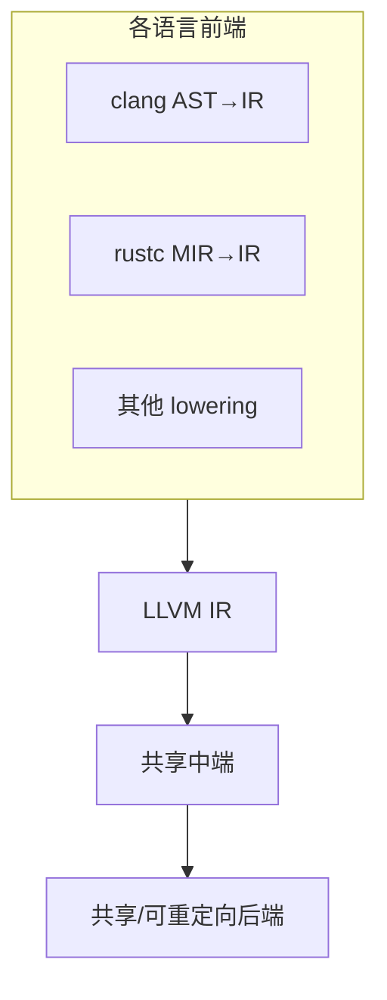

# clang 与其他前端如何接入 LLVM

LLVM 是 IR、优化通道与可重定向后端的共享库集合；完整语言编译器还要自带前端。语言前端负责词法到语义，再把合法程序 **lowering** 成 LLVM IR（内存中的 `Module`，或文本/位码）；之后可调用同一套 `opt` 通道与 `llc`/目标机器发射。不同语言的差异主要停在「如何生成 IR」。

## clang

clang 是 C/C++/Objective-C 的官方 LLVM 前端。预处理与语法/语义在 clang 侧完成；CodeGen 遍历 AST，发射函数、全局量、调试元数据与 TBAA 等。用户命令 `clang -emit-llvm` 停在 IR；默认链接驱动则继续跑中端与后端，再调系统汇编器/链接器。C 的 UB 边界、`restrict`、有符号溢出等，在 CodeGen 时变成 `nsw`/`nuw`、`noalias` 等，见 [语言语义在 LLVM 边界上的损失](llvm-semantics-limits.md)。

同一驱动也负责选择目标三元组、CPU 特性与优化等级，把 `-O2` 映射到一组 pass pipeline。对口试而言：clang = 语言前端 + 对 LLVM API 的驱动；「LLVM」一词有时被口语用来指整条 clang 管线，技术上应区分前后端归属。

## rustc 与其他接入方式

**rustc** 在 Mir 等语言 IR 上完成借用检查与大量 Rust 专用变换，再通过 LLVM 后端（或实验性替代后端）发射目标码。对外 `extern "C"` 的函数按 C ABI 生成；Rust 内部符号可采用不同约定与名字修饰。因此「Rust 程序里的一次调用」是否遵守 SysV，取决于该函数在 FFI 边界的哪一侧。

历史上 **Swift**、部分 **Julia**、**Zig**、**Haskell**（GHC LLVM 后端）等也曾或仍在使用 LLVM 做代码生成。接入模式大致三种：链上官方库生成 IR；写位码/IR 文本再喂给 `llc`；或嵌入 ORC/MCJIT 做运行时编译。共同前提是：前端已解决类型与安全策略，交给 LLVM 的是「足够低、足够显式」的操作。

## 前端仍必须自己做的事

内存管理策略（RC、GC、手工 `free`）、对象模型、泛型单态化或擦除、方法派发、与运行时库的约定，仍由前端与运行时决定。GC 语言需配合 safepoint、stack map 或非 LLVM 运行时；LLVM 提供挂钩点。调试信息、行号与变量位置由前端插入 DI 元数据，后端再写成 DWARF 等，见 [调试信息与 DWARF](debug-dwarf.md)。语言语义与诊断在前端结束；跨语言可共享的优化与机器码生成从 LLVM IR 开始。
