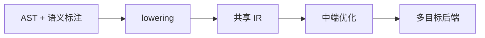
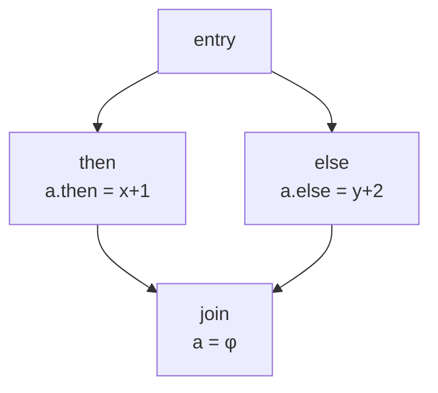

# 中间表示与优化

编译器先把源程序变成便于分析的中间表示，再在语言抽象机允许的范围内删除、合并或重排计算。本节从前端、LLVM IR、SSA 到中端变换，并说明进入 LLVM 时已经固定下来的语义假定。

### 词法分析

词法器读入源文件字符，按最长匹配或语言规定的规则吐出 token 流：关键字、标识符、字面量、运算符、标点。空白与多数注释在这一层被丢弃（或只留下调试用位置信息）。预处理语言（如 C）往往在真正词法之前还有宏展开与 `#include` 拼接；展开后的字符流才进入常规 lexer。

错误以「无法构成合法 token」为主：非法转义、未终止字符串、数字字面量越界写法。词法层通常不做类型判断——`foo` 只是标识符，是否为类型名留给语义阶段。

### 语法分析

语法器用上下文无关文法（或扩展）识别声明与语句结构，产出 AST / CST。递归下降、LR/LALR（yacc/bison 一类）、PEG 等都是实现手段；口试关心的是产物形状：哪些节点对应函数体、哪些对应表达式树、控制流在树上如何出现。

二义性与优先级由文法或解析器动作固定：`a + b * c` 的结合、`if`/`else` 悬挂、C 里 typedef 名与普通标识符的上下文敏感问题，都在这一层或「词法+语法协作」里解决。语法错误恢复策略（跳过到下一语句边界等）影响诊断质量，不改变后续 IR 的语义模型。


读图顺序：字符 → token → 树。语义分析吃的是树，不是再扫一遍源文件。

### 与后续阶段的分界

词法与语法保证的是**合式结构**。名字是否已声明、类型是否匹配、重载如何选定、常量表达式能否在编译期求值，属于语义分析。许多工业前端把「需要符号表的消歧」嵌进 parsing（C/C++ 尤甚），但概念上仍应分开：树形状 vs 树标注。

前端产出进入 IR 之前，通常还要做作用域绑定、类型检查与显式化（插入隐式转换、单态化实例等）。这些步骤及其「为何要降低到统一 IR」见 [语义分析与 IR 设计动机](semantic-ir-motivation.md)。落到 LLVM 之后的模块与基本块形态见 [LLVM IR 核心概念](llvm-ir.md)。

语义分析在 AST（或等价结构）上绑定名字、检查类型与语言规则，并把合法程序变成更适合变换与代码生成的中间表示。IR 把前端语言差异挡在边界之外，让优化与后端面对相对稳定的操作集。

### 语义分析

在已解析的树上，编译器建立作用域与符号表：每个标识符解析到唯一声明（或重载集中的选定成员）。类型检查验证运算、调用、返回、初始化是否符合语言规则；需要时插入隐式转换、装箱、方法派发所需的额外节点。常量折叠的一部分也可在此发生，但大规模、跨基本块的传播通常留给 IR 上的通道。

控制流在源码里可能是 `if`/`while`/`for`/`match`；语义阶段会确认 break/continue 目标合法、不可达代码是否按语言诊断，并把「可执行路径」准备成后续 CFG 构建的输入。对有生命周期、借用或效果系统的语言，这一阶段还要排出违例——违例程序根本不应进入 LLVM。

### AST 与汇编之间的缺口

AST 贴近语法：嵌套深、节点种类随语言膨胀，同一语义可有多种表面写法。在 AST 上做全局数据流分析，要反复处理「语法糖展开后是否等价」的问题。目标汇编又绑定寄存器编号、调用约定与指令编码，换一个 CPU 就要重写生成逻辑。

中间表示把程序压成较平坦的指令序列（或图），操作码集合有限且带显式类型/类型约束。优化写成「识别某种指令模式 → 改写」，后端写成「IR 模式 → 机器指令模式」。同一套中端可以服务 C、Rust、Swift 等前端，只要它们都 lowering 到约定好的 IR。



### 多层 IR 与「语义何时定死」

真实编译器常有多层：语言专用高级 IR（保留部分源级结构）→ 中级 IR（SSA、显式内存）→ 机器相关 IR。每降一层，丢掉一些语言概念、换得更机械的变换。对 LLVM 路线而言，进入 [LLVM IR](llvm-ir.md) 时，求值顺序、别名假定、整数包装规则等已经以指令与属性的形式定型；之后优化按这些假定改写。哪些语言事实会在边界上收缩或消失，见 [语言语义在 LLVM 边界上的损失](llvm-semantics-limits.md)。语义分析保证合法程序并补全隐含结构；SSA 等形式是为分析服务的约束，见 [SSA 形式与 φ 节点](ssa.md)。

LLVM IR 是一种面向静态单赋值（SSA）的低级中间语言：比 C 更接近机器（显式控制流、显式内存访问），又比汇编更抽象（无限虚拟寄存器、机器无关类型）。clang 等前端把语言语义翻译成 IR 之后，优化与多数后端工作都在这层或其衍生形式上完成。

### 模块、函数与基本块

顶层单位是 **module**（通常对应一个翻译单元经过前端后的结果），内含函数、全局变量与元数据。函数由若干 **basic block** 组成：块内指令顺序执行，控制流只在块末尾通过分支、跳转、返回等终结指令离开。块与块之间的边构成控制流图（CFG）。

IR 文本里，函数名与全局符号常以 `@` 开头，局部值以 `%` 开头。例如：

```llvm
define i32 @add(i32 %a, i32 %b) {
entry:
  %sum = add i32 %a, %b
  ret i32 %sum
}
```

`entry` 是入口块标签；`%sum` 是一条 `add` 的结果名。在 SSA 下，这个名字在静态上只会由这一处定义。

### 类型与内存

IR 有显式类型：`i1`/`i8`/`i32`/`i64`、指针、数组、结构体、向量等。算术指令带类型，避免「同一操作码默认字长」的汇编式含糊。

栈上槽位通过 `alloca` 分配，再用 `load` / `store` 访问。许多前端先把局部变量都建成 `alloca`，随后由 mem2reg 一类通道提升为 SSA 寄存器值。堆与全局对象则通过指针操作；IR 本身不内建垃圾回收，GC 策略由语言运行时与相关 intrinsic/元数据配合。

调用写作 `call`（或可尾调用的 `tail call` 等形式），参数与返回类型写在指令上。异常路径在 LLVM 里另有 `invoke`/`landingpad` 等机制；C 一类不抛异常的语言通常只生成普通 `call`。

### 与汇编的对照方式

读 IR 时抓住三件事：CFG 长什么样、值从哪条指令来、内存访问是否还在。`-O0` 的 IR 往往充满 `alloca`/`load`/`store`，几乎是「带类型的栈机」；`-O2` 之后许多局部值变成纯 SSA 名，循环与调用形态也会变。对照同一函数的 `llc` 或 `clang -S` 输出，可以看到虚拟寄存器如何落到物理寄存器、`call` 如何遵从目标 ABI。

更完整的 SSA 与 φ 节点见 [SSA 形式与 φ 节点](ssa.md)。语言在进入 IR 之前已经丢掉或固化了哪些语义，见 [语言语义在 LLVM 边界上的损失](llvm-semantics-limits.md)。

!!! example "自行导出"

    ```bash
    clang -O0 -emit-llvm -S -o f.ll f.c
    clang -O2 -emit-llvm -S -o f.O2.ll f.c
    ```

    先读 `-O0` 建立块与 `alloca` 直觉，再读 `-O2` 看名字与内存访问如何消失或合并。

静态单赋值（Static Single Assignment, SSA）要求：每个名字在程序文本上只被赋值一次。控制流合流时，同一变量在不同前驱块里可能有不同版本，于是在合流块入口用 **φ（phi）函数** 按「从哪条边进来」选择版本。

### 菱形控制流

考虑：

```c
int f(int x, int y, int c) {
  int a;
  if (c)
    a = x + 1;
  else
    a = y + 2;
  return a;
}
```

在 SSA 里，`then` 块产生 `%a.then`，`else` 块产生 `%a.else`，汇合块写：

```llvm
%a = phi i32 [ %a.then, %then ], [ %a.else, %else ]
ret i32 %a
```

φ 是 IR 里的合流记号：后端会把它实现成「在前驱末尾把值搬到同一寄存器/槽位」或等价的数据流安排。



### 与 alloca 形式的关系

前端常先生成：

```llvm
%a.addr = alloca i32
; ...
store i32 %v, ptr %a.addr
; ...
%a = load i32, ptr %a.addr
```

mem2reg 等通道在证明地址未逃逸后，把槽位提升为 SSA 值，并在合流处插入 φ。`-O0` 常保留大量 `alloca`，方便调试器把「变量」对应到栈槽；`-O2` 后变量可能只活在寄存器里，或被拆成多个 SSA 名。断点处「看不到原来的 `a`」，是因为源级名字与机器状态的一一对应被优化合法地打破了。DWARF 如何描述「变量现在在哪个寄存器/偏移」，见 [调试信息与 DWARF](debug-dwarf.md)。

### 优化与 SSA

每个定义唯一，数据流分析可以按「定义 → 使用」建链，常量传播、死代码删除、公共子表达式消除等通道的表述更干净。支配树上的放置规则决定 φ 插在哪里。优化改写的是 SSA 数据流图；源级局部变量布局不在保护范围内。

中端在机器无关（或弱相关）的 IR 上改写程序：删除无用计算、合并等价表达式、内联函数、变换循环等。旗标如 `-O0` / `-O2` / `-O3` 大致对应「几乎不改」到「较激进地改」；具体通道集合随编译器版本变化。对话时抓住变换类别与合法性前提即可。

### 几类常见变换

**常量折叠与常量传播**把编译期已知的表达式换成常量，并顺着 SSA 使用链替换。**死代码删除（DCE）**去掉没有副作用且结果未被使用的指令；若某段代码的唯一作用是「在 UB 情形下才有意义的检查」，在「假定无 UB」后也可能变成死代码。

**内联**把被调函数体嵌入调用点，消除调用开销并打开后续优化，同时可能增大码体积。递归 fibonacci 在足够小的 \(n\) 或特殊形式上，有时会被改得不再像源码里的双递归——此时基准比较的已不是「同构算法」。

**循环优化**包括不变式外提、强度削弱、向量化尝试等。对基准而言，空循环或结果未使用的循环可能被整段删掉；黑盒函数、`DoNotOptimize` 一类手段的存在，正是为了阻止这类合法删除。

### 与 `-O0` / `-O2` 对照

`-O0` 倾向保留 `alloca`、逐条对应源码的加载存储，便于调试。`-O2` 提升 SSA、内联、消除冗余后，局部变量可能不再有栈槽，指令顺序也与源码行交错。同一份 C 源用两种旗标导出 IR/asm，是理解中端的最快实验；步骤见 [从 C 到 LLVM IR 到目标码](c-to-asm-lab.md)。

合法性始终挂在语言抽象机上：对有定义的执行，可观察行为应保持 as-if；对触发 UB 的执行，标准不再约束结果。见 [未定义行为与抽象机](../ch04/ub-abstract-machine.md) 与 [语言语义在 LLVM 边界上的损失](llvm-semantics-limits.md)。

优化再大胆，也不能发明语言里没有的保证。前端在 IR 上留下的旗标与元数据，就是合法性边界。

前端必须在生成 LLVM IR 之前（或同时用元数据）决定许多语言级事实。IR 擅长表达控制流、标量数据流与显式内存访问；它不自动保留「这门语言里指针可以别名什么」「对象生命周期在哪条作用域结束」「指针还能否比较、解引用」的完整故事。

### 进入 IR 时已经定型的东西

求值顺序与副作用切分：哪些子表达式的副作用已排序进指令序列，在 IR 里变成确定的 `load`/`store`/`call` 次序。类型在运行时的去留：单态化后的具体函数与擦除后的统一表示，表现为不同的函数族或指针用法。未定义行为的边界：前端若把某运算标成 `nsw`（no signed wrap）、`nuw`、`exact` 等旗标，等于把「这类异常情况不发生」交给优化器当公理。

C 的 `restrict`、Fortran 式别名规则、Rust 对 `&mut` 不别名的保证，都会变成参数属性或元数据；一旦写进 IR，中端就可以按「无别名」重排与消除内存访问。

### poison、undef 与别名信息

LLVM 用 `poison` / `undef` 表示某些异常值及其传播（以 LangRef 为准）。对带 `nsw` 的有符号加，若按语言规则溢出本属 UB，前端仍可生成 `add nsw`；优化器在「永不产生溢出 poison」的假定下做代数简化，于是源码里依赖「溢出后比较」的分支可以消失。这与 [未定义行为与抽象机](../ch04/ub-abstract-machine.md) 中的 as-if 推理是同一条链在 IR 上的落点。

TBAA（type-based alias analysis）元数据按语言类型分层描述「这两类对象不应别名」。`noalias`、`alias.scope` / `noalias` 元数据把更细的不相交声明传给 AA。前端标错或标过强，等于把语言未保证的命题交给优化器。

### 生命周期与栈槽

`lifetime.start` / `lifetime.end` intrinsic 标出栈对象在抽象机中的活跃区间，供栈槽重用与部分内存优化使用。它们是前端插入的契约：过早 `lifetime.end` 再 `load`，在 IR 语义下接近对已结束生命周期对象的使用。调试信息里的变量位置与这些区间相关，但优化后位置仍可能变成「仅在寄存器」。

### Provenance 轮廓

许多语言在抽象机里让指针携带 **provenance**（来自哪次分配、能合法指向哪块对象），而不只是整数地址。LLVM 的指针在历史上更接近「地址 + 有限别名信息」；部分 provenance 精化仍在演进。前端若把「从整数铸造回来的指针」或「超出对象末尾再折回」的运算按普通 `i64` 地址生成，优化器可能按纯地址代数合并，与语言禁止的指针运算冲突。讨论「取地址再整数往返是否安全」时，要问前端在 IR 里保留了什么，而不是只看目标 ISA 能否把指针当整数加。

### 三个例子

1. **`add nsw`**：C 有符号加法带 `nsw` 后，溢出路径可被当成不可达；检查 `x+1 > x` 一类表达式可被折成常量。  
2. **`noalias` / `restrict`**：两个形参指针标成不别名后，对 `*p` 与 `*q` 的读写可重排或缓存到寄存器，即使源码文本顺序相反。  
3. **`lifetime.end` 后的槽位**：前端结束生命周期后，同一栈槽可被复用；源级「变量 A」与「变量 B」在 asm 里共用地址，调试器按名字看会错位。

口试可直接指认下面两段 IR。第一段里语言级「有符号不溢出」只剩指令旗标；第二段里「两指针不别名」只剩参数属性（还可再附 TBAA 元数据）。

```llvm
; C: int f(int x) { return x + 1; }  — 有符号加，前端标 nsw
define i32 @f(i32 %x) {
  %1 = add nsw i32 %x, 1
  ret i32 %1
}
```

```llvm
; C: void g(int *restrict p, int *restrict q) { *p = 1; *q = 2; }
define void @g(ptr noalias %p, ptr noalias %q) {
  store i32 1, ptr %p
  store i32 2, ptr %q
  ret void
}
```

争论优化是否合法时，先问前端在 IR 上留下了什么假定，再看最终汇编像不像源码。
