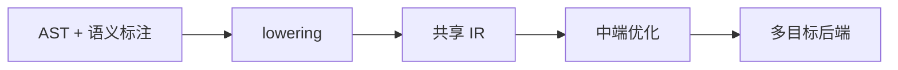

# 语义分析与 IR 设计动机

语义分析在 AST（或等价结构）上绑定名字、检查类型与语言规则，并把合法程序变成更适合变换与代码生成的中间表示。IR 把前端语言差异挡在边界之外，让优化与后端面对相对稳定的操作集。

## 语义分析做的事

在已解析的树上，编译器建立作用域与符号表：每个标识符解析到唯一声明（或重载集中的选定成员）。类型检查验证运算、调用、返回、初始化是否符合语言规则；需要时插入隐式转换、装箱、方法派发所需的额外节点。常量折叠的一部分也可在此发生，但大规模、跨基本块的传播通常留给 IR 上的通道。

控制流在源码里可能是 `if`/`while`/`for`/`match`；语义阶段会确认 break/continue 目标合法、不可达代码是否按语言诊断，并把「可执行路径」准备成后续 CFG 构建的输入。对有生命周期、借用或效果系统的语言，这一阶段还要排出违例——违例程序根本不应进入 LLVM。

## AST 与汇编之间的缺口

AST 贴近语法：嵌套深、节点种类随语言膨胀，同一语义可有多种表面写法。在 AST 上做全局数据流分析，要反复处理「语法糖展开后是否等价」的问题。目标汇编又绑定寄存器编号、调用约定与指令编码，换一个 CPU 就要重写生成逻辑。

中间表示把程序压成较平坦的指令序列（或图），操作码集合有限且带显式类型/类型约束。优化写成「识别某种指令模式 → 改写」，后端写成「IR 模式 → 机器指令模式」。同一套中端可以服务 C、Rust、Swift 等前端，只要它们都 lowering 到约定好的 IR。

## 多层 IR 与「语义何时定死」

真实编译器常有多层：语言专用高级 IR（保留部分源级结构）→ 中级 IR（SSA、显式内存）→ 机器相关 IR。每降一层，丢掉一些语言概念、换得更机械的变换。对 LLVM 路线而言，进入 [LLVM IR](llvm-ir.md) 时，求值顺序、别名假定、整数包装规则等已经以指令与属性的形式定型；之后优化按这些假定改写。哪些语言事实会在边界上收缩或消失，见 [语言语义在 LLVM 边界上的损失](llvm-semantics-limits.md)。语义分析保证合法程序并补全隐含结构；SSA 等形式是为分析服务的约束，见 [SSA 形式与 φ 节点](ssa.md)。
