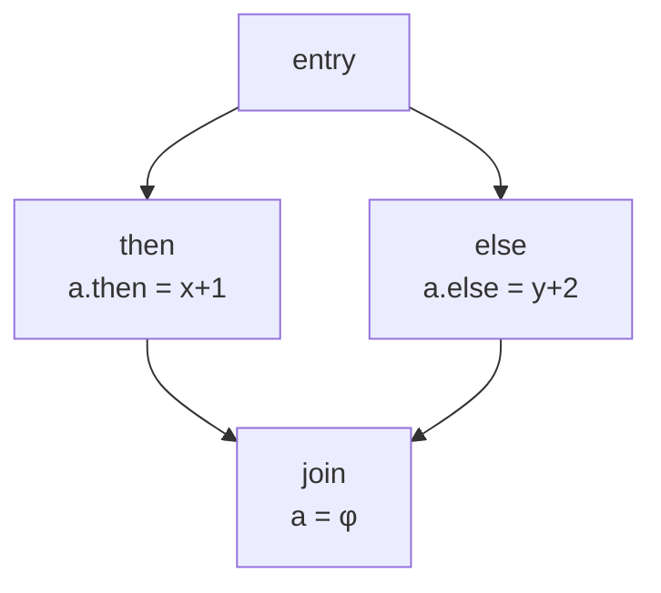

# SSA 形式与 φ 节点

静态单赋值（Static Single Assignment, SSA）要求：每个名字在程序文本上只被赋值一次。控制流合流时，同一变量在不同前驱块里可能有不同版本，于是在合流块入口用 **φ（phi）函数** 按「从哪条边进来」选择版本。

## 菱形控制流

考虑：

```c
int f(int x, int y, int c) {
  int a;
  if (c)
    a = x + 1;
  else
    a = y + 2;
  return a;
}
```

在 SSA 里，`then` 块产生 `%a.then`，`else` 块产生 `%a.else`，汇合块写：

```llvm
%a = phi i32 [ %a.then, %then ], [ %a.else, %else ]
ret i32 %a
```

φ 不是运行时调用的函数，而是 IR 里的合流记号：后端会把它实现成「在前驱末尾把值搬到同一寄存器/槽位」或等价的数据流安排。



## 与 alloca 形式的关系

前端常先生成：

```llvm
%a.addr = alloca i32
; ...
store i32 %v, ptr %a.addr
; ...
%a = load i32, ptr %a.addr
```

mem2reg 等通道在证明地址未逃逸后，把槽位提升为 SSA 值，并在合流处插入 φ。`-O0` 常保留大量 `alloca`，方便调试器把「变量」对应到栈槽；`-O2` 后变量可能只活在寄存器里，或被拆成多个 SSA 名，于是出现「断点处看不到原来的 `a`」——不是调试器坏了，而是源级名字与机器状态的一一对应被优化合法地打破了。

## 为何优化喜欢 SSA

每个定义唯一，数据流分析可以按「定义 → 使用」建链，常量传播、死代码删除、公共子表达式消除等通道的表述更干净。支配树上的放置规则决定 φ 插在哪里；不必在本章展开算法证明，但需要建立直觉：**优化在改写 SSA 图，而不是在保留你的局部变量布局。**

口试时若被要求「画菱形 CFG 并标 φ」，按本节结构画即可；再补一句 mem2reg 前后从内存槽到 φ 的变化。
