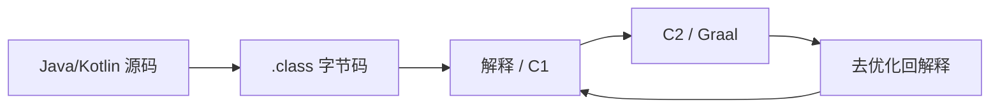

{ width="40" } { width="40" }

# Java 与 Kotlin

JVM 把源语言编成字节码，由 HotSpot（或同类实现）解释、基线编译与 C2/Graal 优化编译接力执行。Kotlin 默认以同一套字节码与运行时为落点；语言表面的空安全、协程、内联类，最终仍映射到对象头、调用约定与调度模型上的具体选择。轴的定义见 [求值与执行模型](../ch04/evaluation.md)、[内存管理轴](../ch04/memory-management.md)、[追踪式 GC](../ch04/gc-mechanics.md)。

## 实现谱系与执行管线

源码经 `javac` / `kotlinc` 生成 `.class`（或 jar 内同类文件）。类加载器按名解析常量池引用，做链接与初始化；字节码由模板解释器或带 profiling 的解释路径执行。热点方法进入 C1 基线编译，再视热度进入 C2 或 Graal：内联、逃逸分析、锁消除、基于类型剖面的去虚化在此发生。墙钟时间因此拆成**冷启动（加载 + 解释）**、**升温（编译队列与去优化）**与**稳态**三段；短基准常落在前两段。

执行模型上，JVM 是典型的「字节码 VM + 多层 JIT」。AOT 路径（GraalVM Native Image、部分 Android ART 流程）把同一字节码语义提前编成机器码，换掉运行期剖面以换取启动与峰值可预期；对话时要先声明测的是哪条管线。Kotlin 的 `inline` 函数在字节码层展开，协程则编成状态机类；二者改变的是生成代码形态，不另起一套堆与 GC。

读图顺序：冷路径走解释与 C1；热路径进优化编译；投机失败则去优化回到可再剖面的路径。

## 内存与对象表示

堆对象带 **mark word** 与 **类指针**（压缩普通对象指针 Compressed Oops 开启时更窄），其后是实例字段；数组另有长度。对象头宽度直接抬高「小对象」的下限成本。布局轴见 [对象表示与运行时布局](../ch04/object-layout.md)。

引用类型一律是指向堆对象的句柄（局部变量与操作数栈上的引用）；`int`/`long`/`double` 等原始类型可内联在栈帧与字段中。赋给 `Object`、泛型擦除后的 `T`、或装箱 API（`Integer`）时发生堆分配。HotSpot 的逃逸分析与标量替换可在证明未逃逸后把分配打回寄存器/栈；是否触发决定微观基准是否「突然变快」。

多态派发：虚方法经接收者类的虚方法表（或 itable 路径处理接口）；`invokevirtual` / `invokeinterface` 在解释器里走解析与缓存，在 JIT 里常被类型反馈收成单态或双态内联。间接层计数方式与 C++ vptr、Go interface 对照见 [派发机制与胖指针](../ch04/polymorphism-repr.md)。Kotlin 的接口默认方法、`inline class`（JVM 后端在可行时擦成底层类型）改变的是调用点能否去装箱，不是另一套对象头格式。

GC 为追踪式分代实现（具体收集器：G1、ZGC、Shenandoah 等）。跨代指针与并发标记依赖 [写屏障](../ch04/gc-mechanics.md)；给引用字段赋值的成本有时来自屏障而非赋值本身。

## 并发与运行时调度

平台线程一对一映射到 OS 线程；`synchronized`、`java.util.concurrent` 与 `volatile` 的语义由 **Java Memory Model（JMM）** 约束：数据竞争在 Java 中不是 C++ 式 UB，但仍可得到「有定义但难推理」的值。可见性与 happens-before 是对话时的正确切口，见 [并发模型](../ch04/concurrency.md)。

虚拟线程（Project Loom）把大量轻量任务多路复用到载体线程上：阻塞在受支持的点时卸载载体，而不是为每个任务永久占用一个大栈 OS 线程。与 Go goroutine 同属 M:N 谱系，但 pin 住载体的操作（某些 JNI、持有监视器的阻塞）会改变扩展性叙事。

Kotlin 协程是编译期状态机 + 用户选择的调度器（`Dispatchers.Default` 等），不是 JVM 内建绿色线程。挂起点由 `suspend` 函数标出；取消与上下文（`CoroutineContext`）沿状态机传递。把协程与虚拟线程混为一谈时，追问：调度实体是谁、阻塞谁、取消如何传播。

## 与 C / ABI 的边界

出 JVM 堆进入本地代码的主路径是 **JNI**（及后续 Panama/`Linker` API）。本地方法按平台调用约定进入 C；参数侧要把 Java 类型编成 C 可理解的表示，字符串与数组常涉及拷贝或临界区指针。JNI 局部/全局引用钉住对象，防止 GC 在本地侧仍持有时回收或搬迁——这是 [FFI 页](../ch04/ffi.md)「所有权与寿命」在 JVM 上的具体形式。

异常不能从 Java 栈帧「自然」穿过任意 C 帧再回到 Java：本地代码须用 JNI 异常检查 API 显式抛出或清除。反向调用（C 调 Java）要求当前线程已 `AttachCurrentThread`。基准里一层 JNI 封装的成本多来自编组、引用管理与安全点交互，而不是单条 `call` 指令。

Kotlin/Native 另有与 LLVM 的互操作与不同的内存模型；本页默认指 **Kotlin/JVM**。若对话落到多平台后端，先声明目标（JVM / Native / JS），再谈 ABI。

## 影响正确性与性能的语义

[类型系统轴](../ch04/typing.md) 上，Java 泛型是擦除：运行时看不到 `List<String>` 与 `List<Integer>` 的 `T`；桥接方法与装箱由此而来。Kotlin 在前端加强空安全与部分内联优化，但擦除边界仍在字节码处。名义类型与单继承 + 接口的派发结构决定 itable/vtable 形态。

整数：`int`/`long` 为二的补码定宽；语言层定义溢出回绕，没有 C 有符号溢出那种 [UB](../ch04/ub-abstract-machine.md)。`Integer` 缓存、自动装箱在循环里制造隐藏分配。`strictfp` 与浮点关联历史细节在现代默认路径上较少成为热点，但跨 JVM 讨论可复现数值时仍可能被问到。

尾调用不被语言保证优化；深度递归 fib 会砸栈或至少无法当成「与 C 同等调用约定距离」的算法。JIT 内联阈值、逃逸分析是否触发、GC 是否在测量窗口内停顿，都会让同构源码的排名抖动。

## 导师对话笔记

- 「Java 比 C 慢多少」要拆成：冷启动 vs 稳态、是否已 C2、有无装箱、GC 是否计入墙钟；不要用单次短跑回答。
- 解释 `synchronized` 时走到 JMM happens-before，而不是「加锁就变慢」的印象句。
- Kotlin 协程 vs 虚拟线程：前者是语言编译产物 + 库调度器，后者是 JVM 调度实体；可组合，不可等同。
- JNI 指针与 Java 引用的寿命：谁 `DeleteLocalRef`、谁钉住、临界区指针在 `Release*` 之后不可再用。
- 泛型擦除的后果：不能 `new T()`、数组协变与运行时 `ClassCastException` 检查落在边界上。
- Compressed Oops、对象头大小如何影响「创建大量小对象」的基准；追问堆参数与收集器名。
