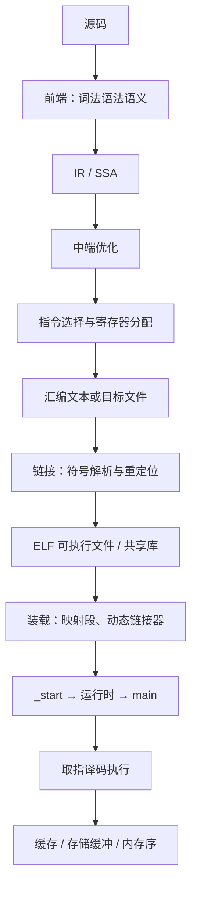

# 从源码到硅片的完整路径

下面这条链是全书的索引图。每一段都应对应到已读章节里的机制，而不是新的一层黑盒。

## 段与责任

| 段 | 主要问题 | 正文入口 |
| --- | --- | --- |
| 前端到 IR | 名字与类型如何变成 CFG 与内存操作 | [第三章概览](../ch03/index.md) |
| 优化 | 哪些变换在「无 UB」假定下合法 | [UB 与抽象机](../ch04/axes-boundary.md)、[SSA](../ch03/ir-and-opt.md) |
| 后端 | 虚拟寄存器如何变成物理寄存器与指令 | [后端轮廓](../ch03/backend-and-debug.md) |
| 链接与 PIC | 符号何时变成地址，GOT/PLT 干什么 | [重定位](../ch02/link-load.md)、[PIC](../ch02/link-load.md) |
| 装载与入口 | 为何不是从 `main` 开始 | [装载](../ch02/link-load.md)、[crt](../ch02/link-load.md) |
| 调用与 ABI | 参数在寄存器还是栈上 | [SysV ABI](../ch02/calling.md) |
| 微架构 | 为何周期数与源码行数不对等 | [流水线](../ch01/machine.md)、[缓存](../ch01/machine.md)、[内存序](../ch01/machine.md) |

语言运行时（JIT、GC、解释器循环）插在「装载之后、持续执行之中」：字节码派发或 JIT 编译出的代码同样进入 CPU 与内存层次。读基准时先判断数字落在链的哪一段，再比较语言差异。
