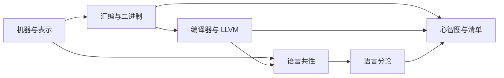

# 阅读说明

## 读者与终点

假定你会写一点高级语言，碰过几行汇编助记符，但还不能稳定解释「编译器为什么可以这样改你的程序」或「一次函数调用在二进制里长什么样」。终点不是背完术语表，而是能按 [口试量规](Spec/oral-rubric.md) 指着具体机制作答。

## 章节依赖

第一章为后文提供硬件词汇。第二章给出可检验的二进制事实。第三章说明优化与 IR 如何改写那些事实。第四章抽出跨语言的轴。第五章只写各语言在这些轴上的落点。第六章把整条链收成可对话的图与清单。

## 实验环境

主线以 **Linux x86-64**、System V AMD64 ABI、ELF 为准。AArch64 只作对照，不平行铺开第二套全书。建议工具：

- 编译与反汇编：`clang` / `gcc`、`objdump`、`readelf`、`nm`
- LLVM 管线：`clang -emit-llvm`、`opt`、`llc`
- 可选观测：`perf`、`gdb`

macOS 上可以完成多数 IR/汇编阅读，但系统调用号、动态链接细节与 Linux 不同；涉及装载与 syscall 的实验以 Linux（实体机、虚拟机或容器）为准。

## 记号

- 行内代码表示标识符、旗标、指令助记符。
- 汇编示例默认 AT&T 语法；出现 Intel 语法时会标明。
- 短公式写在句内，例如写惩罚 \(W_{\mathrm{RAID5}}=4\) 这类关系；长推导才用独立公式块。
- 「导师对话笔记」只列可被追问的事实点，不作学习安排。

## 与基准网站的关系

[benjdd/languages](https://github.com/bddicken/languages) 一类对照适合当提问材料：同一算法、不同语言、不同数量级，背后通常是调用约定、分配、整数语义、JIT 与优化是否改写了算法。读法见 [性能数字的读法](ch06/reading-benchmarks.md)。
